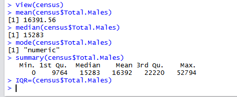
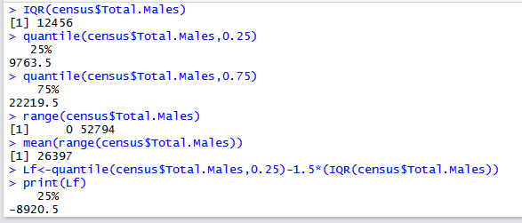
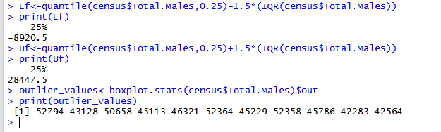

# EX.NO: 01 - CENTRAL TENDENCY AND DATA DISPERSION MEASURES USING R-TOOL

---

## 📌 Problem Statement
Download the dataset from the UCI repository (or) any other appropriate website and implement the central tendency measures (mean, median, mode and midrange) and Data dispersion technique including summary.

---

## 📖 Description
This data comes from the 2010 census profile of general population and housing characteristics. Attributes include Total.Males for LA city boundaries.

- **Primary Tool:** `R Programming / RStudio`
- **Dataset:** [`../../datasets/census.csv`](../../datasets/census.csv)
- **Script File:** [`code.R`](./code.R)

---

## 💻 R Programming Code (`code.R`)

```R
# ==============================================================================
# EX.NO: 01 - CENTRAL TENDENCY AND DATA DISPERSION MEASURES USING R-TOOL
# DATASET: census.csv
# ==============================================================================

# 1. Load Dataset
data_path <- if (file.exists("../../datasets/census.csv")) "../../datasets/census.csv" else "census.csv"
census <- read.csv(data_path)

cat("--- DATASET OVERVIEW ---\n")
print(head(census))

# 2. Central Tendency Measures
cat("\n--- CENTRAL TENDENCY MEASURES ---\n")
# (i) Mean
mean_val <- mean(census$Total.Males, na.rm = TRUE)
cat("i.   Mean (census$Total.Males):", mean_val, "\n")

# (ii) Median
median_val <- median(census$Total.Males, na.rm = TRUE)
cat("ii.  Median (census$Total.Males):", median_val, "\n")

# (iii) Mode
# Built-in R mode() returns storage type ("numeric")
cat("iii. Built-in mode(census$Total.Males):", mode(census$Total.Males), "\n")

# Statistical Mode function
get_mode <- function(v) {
  uniqv <- unique(na.omit(v))
  uniqv[which.max(tabulate(match(v, uniqv)))]
}
cat("     Statistical Mode:", get_mode(census$Total.Males), "\n")

# (iv) Summary Table
cat("\niv.  Summary Table:\n")
print(summary(census$Total.Males))

# 3. Measures of Dispersion
cat("\n--- MEASURES OF DISPERSION ---\n")
# (i) Inter Quartile Range (IQR = Q3 - Q1)
iqr_val <- IQR(census$Total.Males, na.rm = TRUE)
cat("i.   IQR (census$Total.Males):", iqr_val, "\n")

# (ii) Quartiles (Q1 = 25%, Q3 = 75%)
q1 <- quantile(census$Total.Males, 0.25, na.rm = TRUE)
q3 <- quantile(census$Total.Males, 0.75, na.rm = TRUE)
cat("ii.  Quartile Q1 (25%):", q1, "\n")
cat("     Quartile Q3 (75%):", q3, "\n")

# (iii) Mid Range = (Max + Min) / 2
rng <- range(census$Total.Males, na.rm = TRUE)
mid_range <- mean(rng)
cat("iii. Range [Min, Max]: [", rng[1], ",", rng[2], "]\n")
cat("     Mid Range:", mid_range, "\n")

# (iv) Outliers Detection (Tukey's Fences)
# Lower Fence = Q1 - 1.5 * IQR
# Upper Fence = Q3 + 1.5 * IQR
lower_fence <- q1 - 1.5 * iqr_val
upper_fence <- q3 + 1.5 * iqr_val
cat("iv.  Lower Fence:", lower_fence, "\n")
cat("     Upper Fence:", upper_fence, "\n")

outlier_values <- boxplot.stats(census$Total.Males)$out
cat("\nOutlier Values (Values outside fences):\n")
print(outlier_values)

# Save Plot
png("dispersion_boxplot.png", width = 700, height = 500)
boxplot(census$Total.Males, main = "Boxplot with Outliers for Total Males",
        ylab = "Total Males", col = "lightblue", border = "darkblue")
dev.off()
cat("\nBoxplot saved to dispersion_boxplot.png\n")

```

---

## 🚀 How to Run in RStudio
1. Open **RStudio**.
2. Set working directory to this experiment folder or the repository root:
   ```R
   setwd("D:/DWDM-Lab-Experiments/experiments/EXP01 - Central Tendency and Data Dispersion Measures")
   ```
3. Open and run [`code.R`](./code.R):
   ```R
   source("code.R")
   ```

---

## 📸 Full Lab Manual Reference Screenshots (3 Total)

#### Screenshot 1: `step_01_page_01_Image15.png`



---

#### Screenshot 2: `step_02_page_02_Image20.png`



---

#### Screenshot 3: `step_03_page_02_Image21.png`



---


---

## 🎯 Result
> [!NOTE]
> **Thus the central tendency and measures of dispersion have been executed successfully in RStudio. The outlier values are from more than upper fence; there are no lower fence values.**
