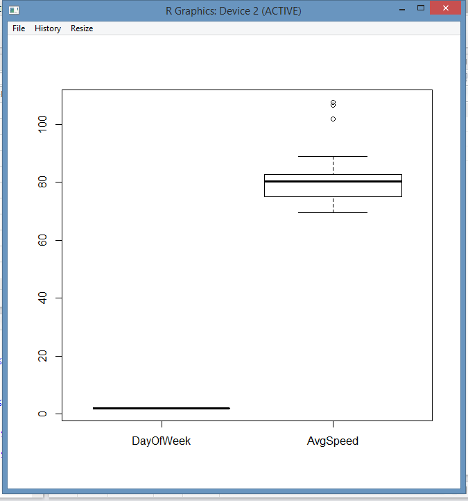
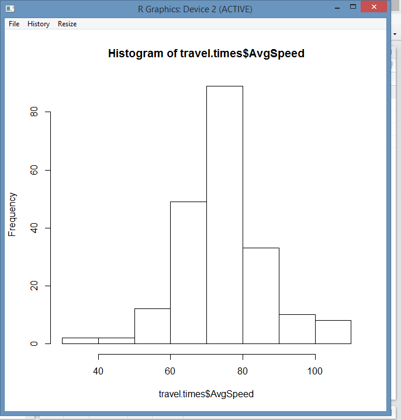
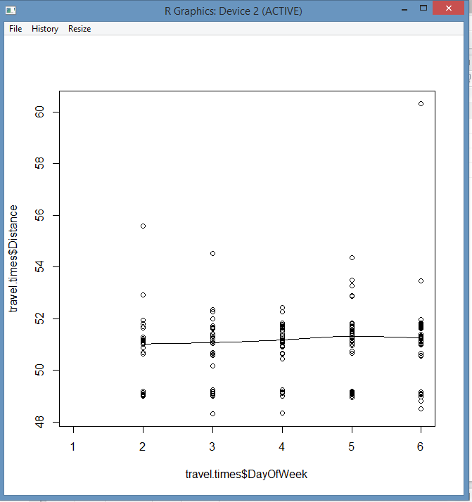

# EX.NO: 02 - PLOTTING GRAPHS USING R-TOOL

---

## 📌 Problem Statement
Plot the boxplot, histogram and scatterplot for the dataset which was taken in the previous exercise.

---

## 📖 Description
Consider a dataset travel.times.csv, containing attributes: Date, StartTime, DayOfWeek, Goingto, Distance, MaxSpeed, AvgSpeed, AvgMovingSpeed, FuelEconomy, TotalTime, MovingTime, Take407All, Comments.

- **Primary Tool:** `R Programming / RStudio`
- **Dataset:** [`../../datasets/travel.times.csv`](../../datasets/travel.times.csv)
- **Script File:** [`code.R`](./code.R)

---

## 💻 R Programming Code (`code.R`)

```R
# ==============================================================================
# EX.NO: 02 - PLOTTING GRAPHS USING R-TOOL
# DATASET: travel.times.csv
# ==============================================================================

# 1. Load Dataset
data_path <- if (file.exists("../../datasets/travel.times.csv")) "../../datasets/travel.times.csv" else "travel.times.csv"
travel.times <- read.csv(data_path)

cat("--- DATASET PREVIEW ---\n")
print(head(travel.times[, c("Date", "DayOfWeek", "Distance", "MaxSpeed", "AvgSpeed")]))

# ------------------------------------------------------------------------------
# (i) BOXPLOT : DayOfWeek and AvgSpeed (Friday vs Monday)
# ------------------------------------------------------------------------------
travel1 <- travel.times[which(travel.times$DayOfWeek == "Friday"), names(travel.times) %in% c("DayOfWeek", "AvgSpeed")]
travel2 <- travel.times[which(travel.times$DayOfWeek == "Monday"), names(travel.times) %in% c("DayOfWeek", "AvgSpeed")]

png("boxplot_output.png", width = 700, height = 500)
boxplot(travel1$AvgSpeed, travel2$AvgSpeed,
        names = c("Friday", "Monday"),
        col = c("lightblue", "lightgreen"),
        main = "Boxplot Analysis: DayOfWeek vs AvgSpeed",
        xlab = "DayOfWeek", ylab = "AvgSpeed")
dev.off()
cat("i.   Boxplot saved to boxplot_output.png\n")

# ------------------------------------------------------------------------------
# (ii) HISTOGRAM : Frequency Distribution of AvgSpeed
# ------------------------------------------------------------------------------
png("histogram_output.png", width = 700, height = 500)
hist(travel.times$AvgSpeed,
     col = "orange", border = "black",
     main = "Histogram of travel.times$AvgSpeed",
     xlab = "travel.times$AvgSpeed",
     ylab = "Frequency")
dev.off()
cat("ii.  Histogram saved to histogram_output.png\n")

# ------------------------------------------------------------------------------
# (iii) SCATTERPLOT : DayOfWeek vs Distance
# ------------------------------------------------------------------------------
day_factor <- as.numeric(as.factor(travel.times$DayOfWeek))

png("scatterplot_output.png", width = 700, height = 500)
scatter.smooth(day_factor, travel.times$Distance,
               xlab = "travel.times$DayOfWeek",
               ylab = "travel.times$Distance",
               main = "Scatterplot with Loess Smoother",
               col = "blue", pch = 16)
dev.off()
cat("iii. Scatterplot saved to scatterplot_output.png\n")

```

---

## 🚀 How to Run in RStudio
1. Open **RStudio**.
2. Set working directory to this experiment folder or the repository root:
   ```R
   setwd("D:/DWDM-Lab-Experiments/experiments/EXP02 - Plotting Graphs using R-Tool")
   ```
3. Open and run [`code.R`](./code.R):
   ```R
   source("code.R")
   ```

---

## 📸 Full Lab Manual Reference Screenshots (3 Total)

#### Screenshot 1: `step_01_page_05_Image40.png`



---

#### Screenshot 2: `step_02_page_06_Image43.png`



---

#### Screenshot 3: `step_03_page_07_Image46.png`



---


---

## 🎯 Result
> [!NOTE]
> **Thus, the plotting of graphs like boxplot, histogram and scatterplot for the given dataset has been successfully completed using R-Tool.**
