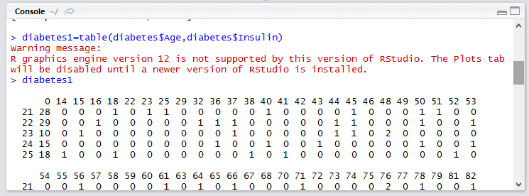
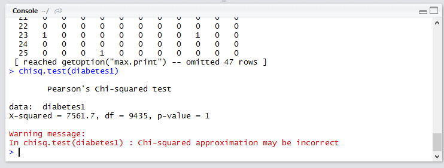
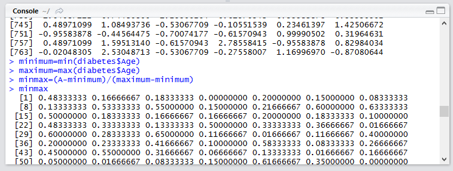
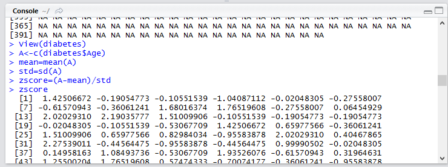
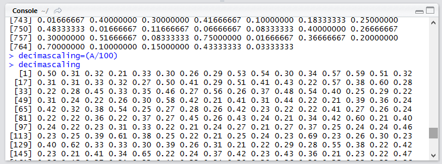

# EX.NO: 03 - PERFORM CORRELATION ANALYSIS AND NORMALIZATION USING R-TOOL

---

## 📌 Problem Statement
Perform the correlation analysis for the numerical attribute using pearson coefficient and for categorical attribute using chi-square and also, perform the normalization technique using min, max, z score and decimal scaling for the given data frames of particular dataset.

---

## 📖 Description
A dataset named diabetes.csv is given for correlation analysis (between Age and Insulin) and normalization techniques.

- **Primary Tool:** `R Programming / RStudio`
- **Dataset:** [`../../datasets/diabetes.csv`](../../datasets/diabetes.csv)
- **Script File:** [`code.R`](./code.R)

---

## 💻 R Programming Code (`code.R`)

```R
# ==============================================================================
# EX.NO: 03 - PERFORM CORRELATION ANALYSIS AND NORMALIZATION USING R-TOOL
# DATASET: diabetes.csv
# ==============================================================================

# 1. Load Dataset
data_path <- if (file.exists("../../datasets/diabetes.csv")) "../../datasets/diabetes.csv" else "diabetes.csv"
diabetes <- read.csv(data_path)

cat("--- DATASET OVERVIEW ---\n")
print(head(diabetes[, c("Age", "Insulin", "Glucose", "BloodPressure")]))

# ------------------------------------------------------------------------------
# 1. CORRELATION ANALYSIS
# ------------------------------------------------------------------------------
cat("\n--- (A) CHI-SQUARE TEST (Age vs Insulin) ---\n")
# Create contingency table
diabetes1 <- table(diabetes$Age, diabetes$Insulin)
cat("Contingency Table Dimensions:", dim(diabetes1), "\n")
print(diabetes1[1:5, 1:5])

# Chi-Square Test
chi_result <- suppressWarnings(chisq.test(diabetes1))
print(chi_result)

# Numerical Pearson Correlation Coefficient
cat("\n--- (B) PEARSON CORRELATION COEFFICIENT ---\n")
pearson_corr <- cor(diabetes$Age, diabetes$Insulin, method = "pearson")
cat("Pearson Correlation (Age vs Insulin):", pearson_corr, "\n")

# ------------------------------------------------------------------------------
# 2. NORMALIZATION TECHNIQUES (On Age Attribute)
# ------------------------------------------------------------------------------
A <- c(diabetes$Age)

# (i) MIN-MAX NORMALIZATION: (A - min) / (max - min)
Minimum <- min(diabetes$Age)
Maximum <- max(diabetes$Age)
MinMax <- (A - Minimum) / (Maximum - Minimum)
cat("\n--- (i) MIN-MAX NORMALIZATION (First 15 values) ---\n")
print(head(MinMax, 15))

# (ii) Z-SCORE NORMALIZATION: (A - mean) / sd
Mean <- mean(A)
Std <- sd(A)
Zscore <- (A - Mean) / Std
cat("\n--- (ii) Z-SCORE NORMALIZATION (First 15 values) ---\n")
print(head(Zscore, 15))

# (iii) DECIMAL SCALING NORMALIZATION: A / 10^j (here divided by 100)
Decimalscaling <- (A / 100)
cat("\n--- (iii) DECIMAL SCALING NORMALIZATION (First 15 values) ---\n")
print(head(Decimalscaling, 15))

```

---

## 🚀 How to Run in RStudio
1. Open **RStudio**.
2. Set working directory to this experiment folder or the repository root:
   ```R
   setwd("D:/DWDM-Lab-Experiments/experiments/EXP03 - Correlation Analysis and Normalization")
   ```
3. Open and run [`code.R`](./code.R):
   ```R
   source("code.R")
   ```

---

## 📸 Full Lab Manual Reference Screenshots (5 Total)

#### Screenshot 1: `step_01_page_08_Image54.png`



---

#### Screenshot 2: `step_02_page_09_Image57.png`



---

#### Screenshot 3: `step_03_page_09_Image58.png`



---

#### Screenshot 4: `step_04_page_10_Image61.png`



---

#### Screenshot 5: `step_05_page_10_Image62.png`



---


---

## 🎯 Result
> [!NOTE]
> **Thus, the correlation analysis and normalization for the given dataset has been successfully executed and observed.**
