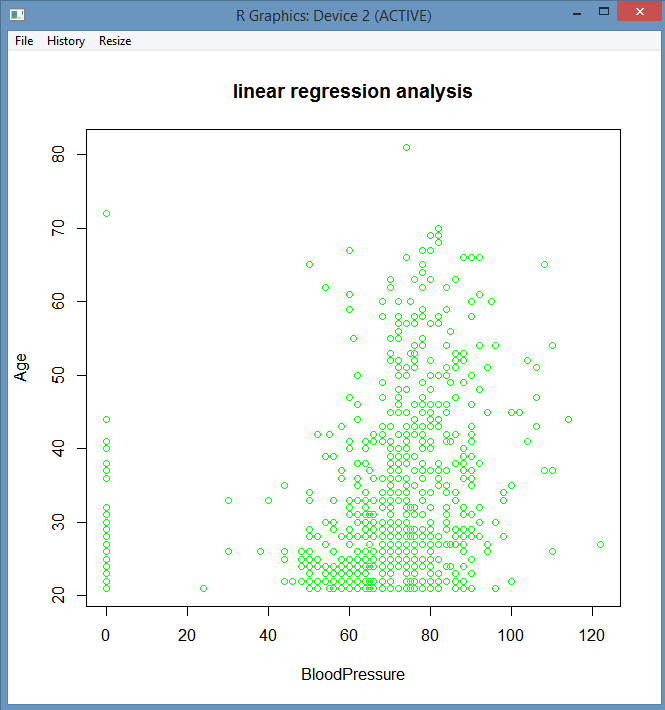
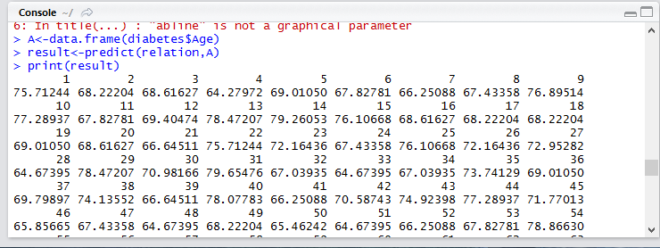
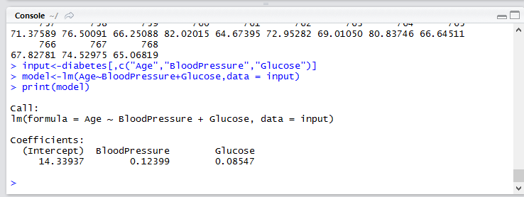
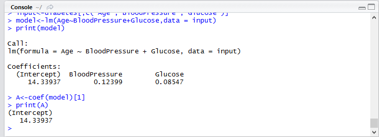
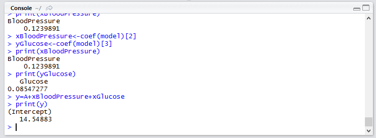
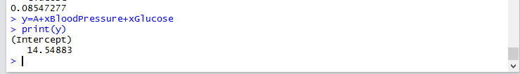

# EX.NO: 04 - REGRESSION ANALYSIS USING R TOOL

---

## 📌 Problem Statement
Perform the linear regression and multiple regression for the given dataset.

---

## 📖 Description
Consider a dataset of diabetes.csv with attributes: pregnancies, Glucose, BloodPressure, SkinThickness, BMI, Diabetes, Age, Outcome. Linear regression between Age and BloodPressure; Multiple regression between Age, BloodPressure, and Glucose.

- **Primary Tool:** `R Programming / RStudio`
- **Dataset:** [`../../datasets/diabetes.csv`](../../datasets/diabetes.csv)
- **Script File:** [`code.R`](./code.R)

---

## 💻 R Programming Code (`code.R`)

```R
# ==============================================================================
# EX.NO: 04 - REGRESSION ANALYSIS USING R TOOL
# DATASET: diabetes.csv
# ==============================================================================

# 1. Load Dataset
data_path <- if (file.exists("../../datasets/diabetes.csv")) "../../datasets/diabetes.csv" else "diabetes.csv"
diabetes <- read.csv(data_path)

# Filter zero values for physiological attributes
diabetes <- diabetes[diabetes$BloodPressure > 0 & diabetes$Glucose > 0, ]

# ------------------------------------------------------------------------------
# 1. SIMPLE LINEAR REGRESSION: BloodPressure ~ Age
# ------------------------------------------------------------------------------
cat("--- SIMPLE LINEAR REGRESSION ---\n")
relation <- lm(diabetes$BloodPressure ~ diabetes$Age)
print(summary(relation))

# Save plot to PNG
png("linear_regression.png", width = 700, height = 500)
plot(diabetes$Age, diabetes$BloodPressure, col = "green", pch = 19,
     main = "Linear Regression Analysis",
     xlab = "Age", ylab = "BloodPressure")
abline(relation, col = "red", lwd = 2)
dev.off()
cat("Linear regression plot saved to linear_regression.png\n")

# Model Prediction
A <- data.frame(diabetes.Age = diabetes$Age)
colnames(A) <- c("diabetes$Age")
result <- predict(relation, newdata = A)
cat("\nPredicted Values (First 10 records):\n")
print(head(result, 10))

# ------------------------------------------------------------------------------
# 2. MULTIPLE LINEAR REGRESSION: Age ~ BloodPressure + Glucose
# ------------------------------------------------------------------------------
cat("\n--- MULTIPLE LINEAR REGRESSION ---\n")
input <- diabetes[, c("Age", "BloodPressure", "Glucose")]
model <- lm(Age ~ BloodPressure + Glucose, data = input)
print(model)

# Extract Coefficients
A_coef <- coef(model)[1]
xBloodPressure <- coef(model)[2]
yGlucose <- coef(model)[3]

cat("\nModel Coefficients:\n")
cat("Intercept (A):", A_coef, "\n")
cat("xBloodPressure:", xBloodPressure, "\n")
cat("yGlucose:", yGlucose, "\n")

# Predicted Age Equation
cat("\nRegression Equation: Age = Intercept + (coef_BP * BP) + (coef_Glucose * Glucose)\n")
sample_y <- A_coef + (xBloodPressure * 80) + (yGlucose * 120)
cat("Predicted Age for BP = 80 and Glucose = 120:", sample_y, "\n")

```

---

## 🚀 How to Run in RStudio
1. Open **RStudio**.
2. Set working directory to this experiment folder or the repository root:
   ```R
   setwd("D:/DWDM-Lab-Experiments/experiments/EXP04 - Regression Analysis using R-Tool")
   ```
3. Open and run [`code.R`](./code.R):
   ```R
   source("code.R")
   ```

---

## 📸 Full Lab Manual Reference Screenshots (6 Total)

#### Screenshot 1: `step_01_page_12_Image69.png`



---

#### Screenshot 2: `step_02_page_13_Image72.png`



---

#### Screenshot 3: `step_03_page_13_Image73.png`



---

#### Screenshot 4: `step_04_page_14_Image76.png`



---

#### Screenshot 5: `step_05_page_14_Image77.png`



---

#### Screenshot 6: `step_06_page_14_Image78.png`



---


---

## 🎯 Result
> [!NOTE]
> **Thus, the linear regression and the multiple regression analysis for the given dataset has been successfully completed.**
