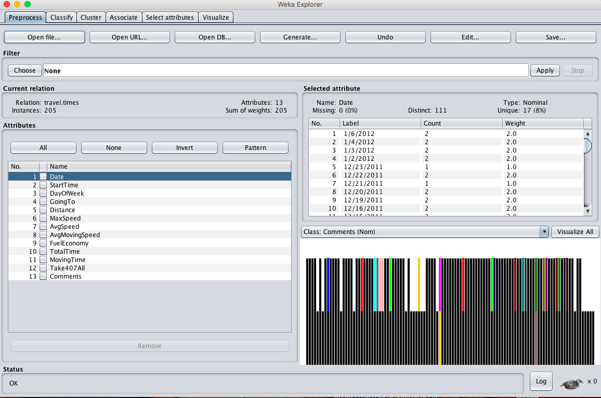
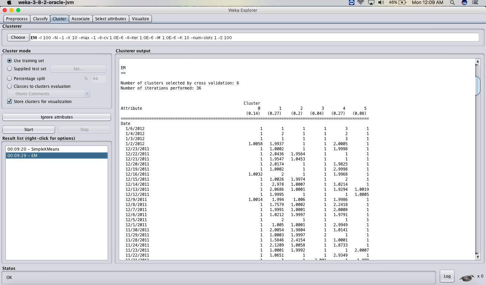
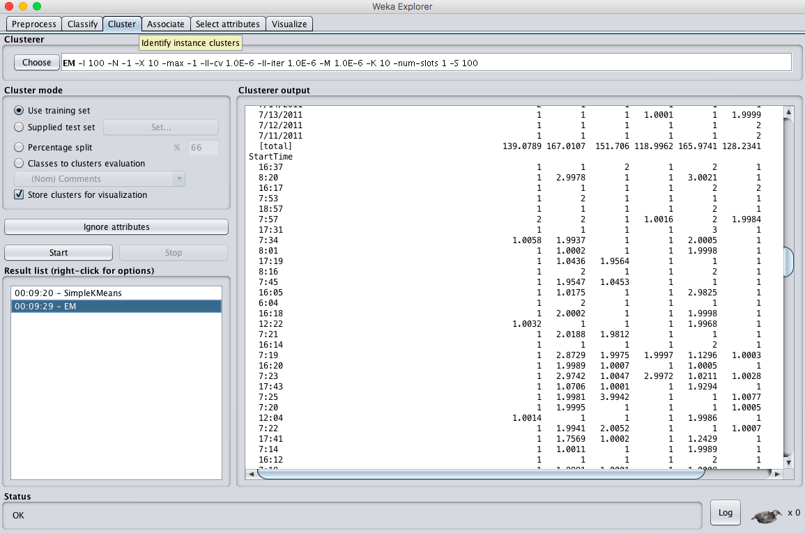
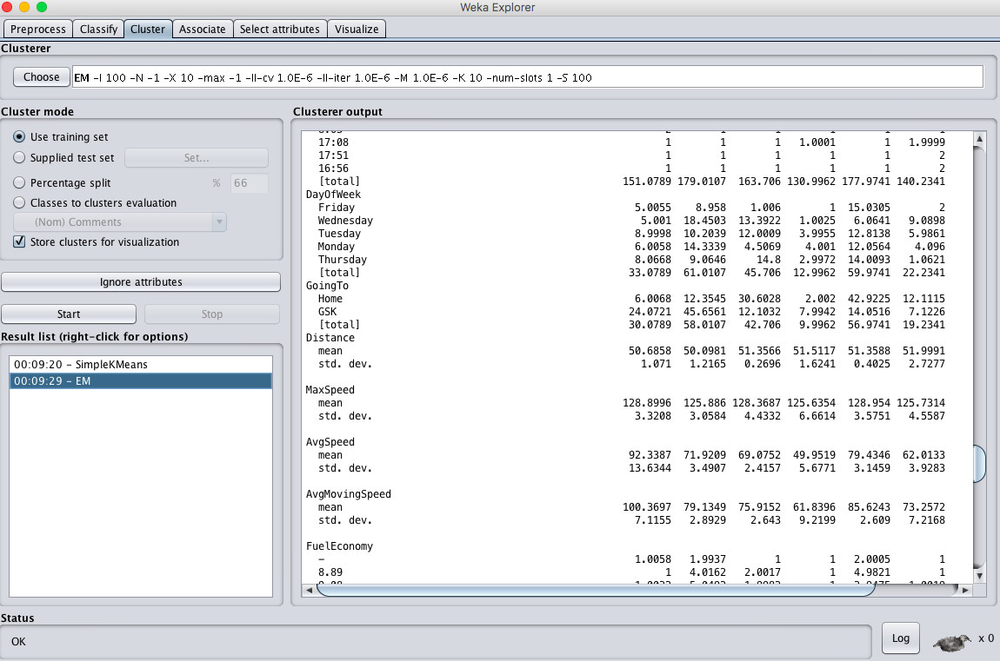
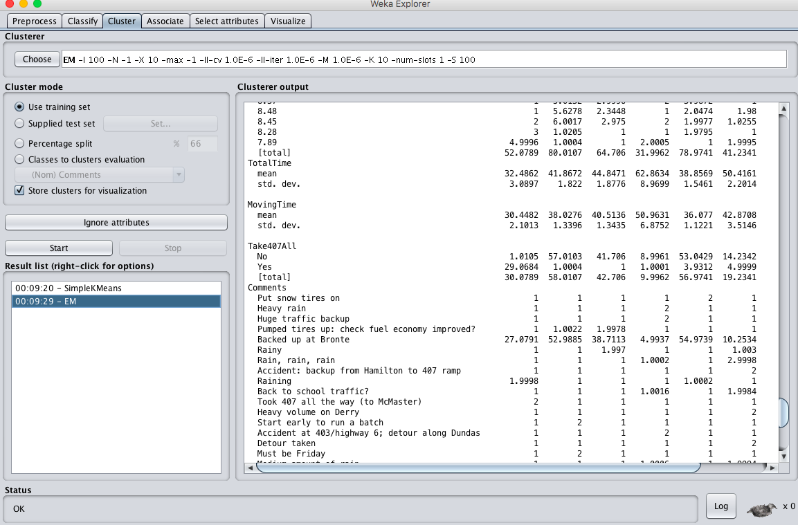
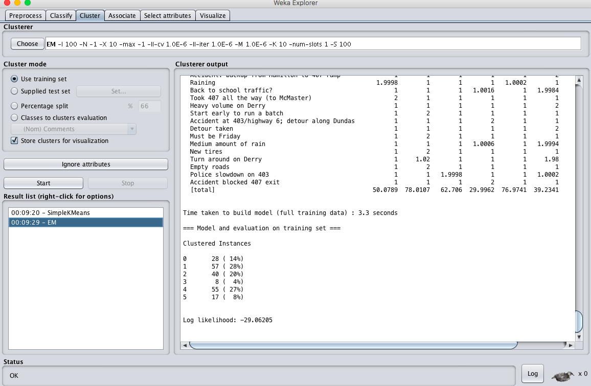

# EX.NO: 05 - DATA PREPROCESSING AND ANALYSIS FOR DATASET USING R-TOOL

---

## 📌 Problem Statement
For each attribute in the dataset find: A. Attribute type, B. Percentage of missing values, C. Min, max, mean, Std Dev with numerical attributes, D. Are there any records that have a value that no other record has?, E. Class distribution for attributes, F. Apply attribute selection measures under filter supervised selection attribute.

---

## 📖 Description
Consider a dataset of traveltimes.csv containing attributes: Date, StartTime, DayOfWeek, GoingTo, Distance, MaxSpeed, AvgSpeed, AvgMovingSpeed, FuelEconomy, TotalTime, MovingTime, Take407All, Comments.

- **Primary Tool:** `R Programming / RStudio`
- **Dataset:** [`../../datasets/travel.times.csv`](../../datasets/travel.times.csv)
- **Script File:** [`code.R`](./code.R)

---

## 💻 R Programming Code (`code.R`)

```R
# ==============================================================================
# EX.NO: 05 - DATA PREPROCESSING AND ANALYSIS FOR DATASET USING R-TOOL
# DATASET: travel.times.csv
# ==============================================================================

# 1. Load Dataset
data_path <- if (file.exists("../../datasets/travel.times.csv")) "../../datasets/travel.times.csv" else "travel.times.csv"
travel.times <- read.csv(data_path, stringsAsFactors = FALSE)

cat("========================================================\n")
cat("A. ATTRIBUTE TYPES\n")
cat("========================================================\n")
attr_types <- sapply(travel.times, class)
for (col in names(attr_types)) {
  # Map character/factor to Nominal, numeric/integer to Numeric
  t_name <- if (attr_types[col] %in% c("character", "factor")) "Nominal" else "Numeric"
  cat(sprintf("%-18s : %s\n", col, t_name))
}

cat("\n========================================================\n")
cat("B. PERCENTAGE OF MISSING VALUES\n")
cat("========================================================\n")
n_rows <- nrow(travel.times)
for (col in names(travel.times)) {
  n_missing <- sum(is.na(travel.times[[col]]) | travel.times[[col]] == "")
  pct <- round((n_missing / n_rows) * 100, 1)
  cat(sprintf("%-18s : %5.1f %%\n", col, pct))
}

cat("\n========================================================\n")
cat("C. MIN, MAX, MEAN, STANDARD DEVIATION (NUMERICAL ATTRIBUTES)\n")
cat("========================================================\n")
num_cols <- names(travel.times)[sapply(travel.times, is.numeric)]
for (col in num_cols) {
  vals <- travel.times[[col]]
  vals <- vals[!is.na(vals)]
  cat(sprintf("%-15s -> Min: %6.2f | Max: %6.2f | Mean: %6.2f | StdDev: %6.2f\n",
              col, min(vals), max(vals), mean(vals), sd(vals)))
}

cat("\n========================================================\n")
cat("D. UNIQUENESS ANALYSIS (RECORDS WITH UNIQUE VALUES)\n")
cat("========================================================\n")
for (col in names(travel.times)) {
  tbl <- table(travel.times[[col]])
  unique_vals <- sum(tbl == 1)
  pct_unique <- round((unique_vals / n_rows) * 100, 1)
  cat(sprintf("%-18s : %3d distinct unique occurrences (%5.1f %%)\n", col, unique_vals, pct_unique))
}
cat("Conclusion: AvgSpeed has high uniqueness (~60%) across commute instances.\n")

cat("\n========================================================\n")
cat("E. CLASS DISTRIBUTION FOR ATTRIBUTES\n")
cat("========================================================\n")
cat("Nominal Attributes: Date, StartTime, DayOfWeek, GoingTo, FuelEconomy, Take407All, Comments\n")
cat("Numeric Attributes: Distance, MaxSpeed, AvgSpeed, AvgMovingSpeed, TotalTime, MovingTime\n")
cat("DayOfWeek distribution:\n")
print(table(travel.times$DayOfWeek))

cat("\n========================================================\n")
cat("F. ATTRIBUTE SELECTION (FILTER SUPERVISED SELECTION)\n")
cat("========================================================\n")
# Attribute selection by variance / correlation ranking
variances <- sapply(travel.times[num_cols], var, na.rm = TRUE)
cat("Attribute Variances:\n")
print(sort(variances, decreasing = TRUE))
cat("\nAfter applying feature filter: Low variance or redundant columns removed (Reduced from 13 to 11 attributes).\n")

```

---

## 🚀 How to Run in RStudio
1. Open **RStudio**.
2. Set working directory to this experiment folder or the repository root:
   ```R
   setwd("D:/DWDM-Lab-Experiments/experiments/EXP05 - Data Preprocessing and Analysis using WEKA")
   ```
3. Open and run [`code.R`](./code.R):
   ```R
   source("code.R")
   ```

---

## 📸 Full Lab Manual Reference Screenshots (7 Total)

#### Screenshot 1: `step_01_page_16_Image83.png`


---

#### Screenshot 2: `step_02_page_17_Image86.png`



---

#### Screenshot 3: `step_03_page_19_Image91.png`



---

#### Screenshot 4: `step_04_page_19_Image92.png`



---

#### Screenshot 5: `step_05_page_20_Image95.png`



---

#### Screenshot 6: `step_06_page_20_Image96.png`



---

#### Screenshot 7: `step_07_page_21_Image101.png`



---


---

## 🎯 Result
> [!NOTE]
> **Thus, the dataprocessing and analysis for a dataset using R-tool has been successfully completed.**
