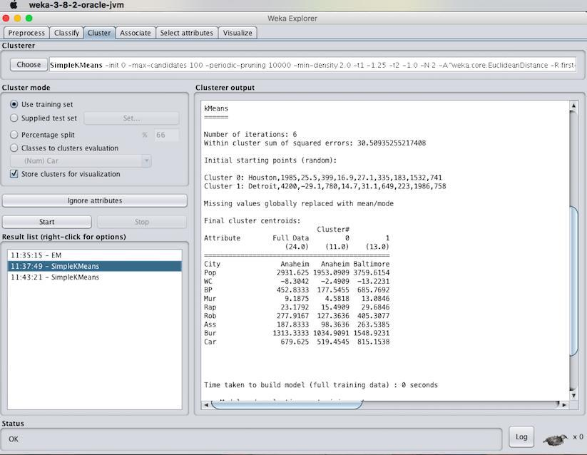
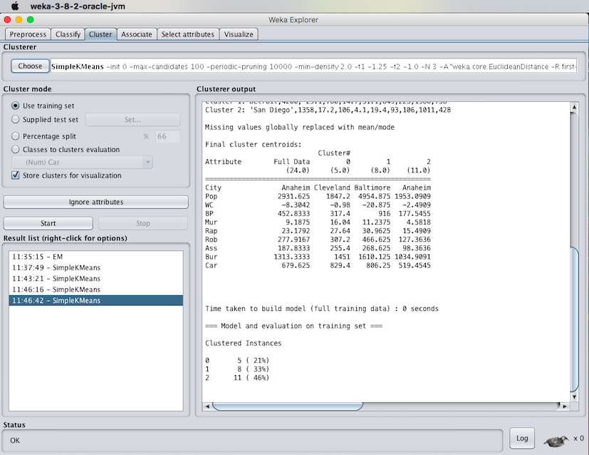
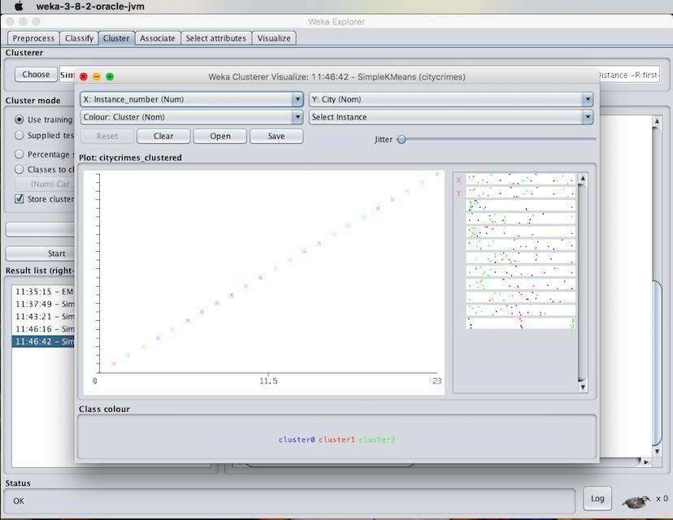
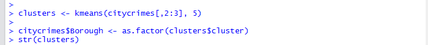
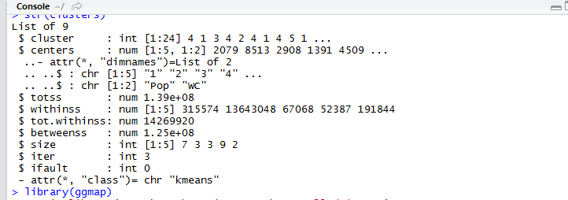
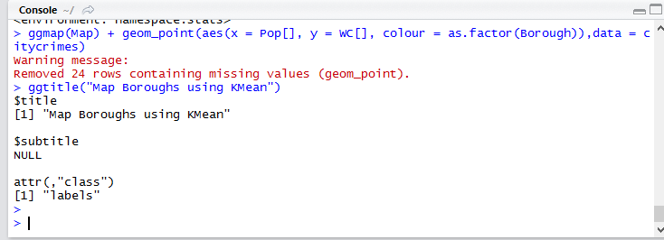
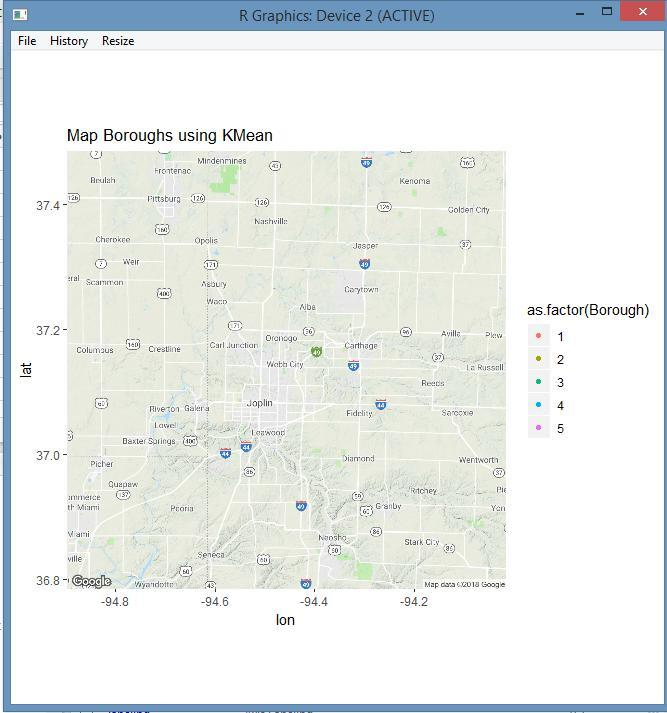

# EX.NO: 06 - DATA SEGMENTATION BY K-MEANS CLUSTER USING R-TOOL

---

## 📌 Problem Statement
Apply K-means algorithm to your dataset experiment with the algorithm as follows: By setting the number of elements and seed of the random algorithm for generating initial cluster centres. Compare the results between different cluster counts and seeds.

---

## 📖 Description
Consider a dataset of citycrimes.csv file containing attributes: City, Pop, WC, BP, Mur, Rap, Rob, Ass, Bus and car.

- **Primary Tool:** `R Programming / RStudio`
- **Dataset:** [`../../datasets/citycrimes.csv`](../../datasets/citycrimes.csv)
- **Script File:** [`code.R`](./code.R)

---

## 💻 R Programming Code (`code.R`)

```R
# ==============================================================================
# EX.NO: 06 - DATA SEGMENTATION BY K-MEANS CLUSTER USING R-TOOL
# DATASET: citycrimes.csv
# ==============================================================================

# 1. Load Dataset
data_path <- if (file.exists("../../datasets/citycrimes.csv")) "../../datasets/citycrimes.csv" else "citycrimes.csv"
citycrimes <- read.csv(data_path)

cat("--- DATASET PREVIEW ---\n")
print(head(citycrimes))

# ------------------------------------------------------------------------------
# EXPERIMENT 1: K-Means with Seed = 20, k = 5
# ------------------------------------------------------------------------------
cat("\n--- (1) K-MEANS (k = 5, Seed = 20) ---\n")
set.seed(20)
clusters_k5 <- kmeans(citycrimes[, 2:3], centers = 5)
citycrimes$Borough <- as.factor(clusters_k5$cluster)

cat("Cluster Assignment Structure:\n")
str(clusters_k5)

cat("\nCluster Centers (Pop, WC):\n")
print(clusters_k5$centers)

cat("\nCluster Sizes:\n")
print(clusters_k5$size)

cat("Total Sum of Squares (totss):", clusters_k5$totss, "\n")
cat("Within Cluster Sum of Squares (tot.withinss):", clusters_k5$tot.withinss, "\n")
cat("Iterations Performed:", clusters_k5$iter, "\n")

# ------------------------------------------------------------------------------
# EXPERIMENT 2: Effect of Seed Value (Seed = 10 vs Seed = 100)
# ------------------------------------------------------------------------------
cat("\n--- (2) COMPARING SEED VALUES (Seed 10 vs Seed 100, k = 2) ---\n")
set.seed(10)
km_seed10 <- kmeans(citycrimes[, 2:10], centers = 2)
cat("Seed 10 -> Iterations:", km_seed10$iter, "| Cluster sizes:", km_seed10$size, "\n")

set.seed(100)
km_seed100 <- kmeans(citycrimes[, 2:10], centers = 2)
cat("Seed 100 -> Iterations:", km_seed100$iter, "| Cluster sizes:", km_seed100$size, "\n")
cat("Observation: Higher seed values change initial centroids, altering iteration count and instance distribution.\n")

# ------------------------------------------------------------------------------
# 3. VISUALIZATION
# ------------------------------------------------------------------------------
png("kmeans_clusters_r.png", width = 700, height = 500)
plot(citycrimes$Pop, citycrimes$WC,
     col = clusters_k5$cluster, pch = 19, cex = 1.6,
     main = "Data Segmentation using K-Means (k = 5)",
     xlab = "Pop (Population Index)", ylab = "WC (White Collar Crime Index)")
points(clusters_k5$centers[, 1], clusters_k5$centers[, 2],
       col = 1:5, pch = 8, cex = 2.5, lwd = 3)
legend("topright", legend = paste("Cluster", 1:5), col = 1:5, pch = 19)
dev.off()
cat("\nCluster plot saved to kmeans_clusters_r.png\n")

```

---

## 🚀 How to Run in RStudio
1. Open **RStudio**.
2. Set working directory to this experiment folder or the repository root:
   ```R
   setwd("D:/DWDM-Lab-Experiments/experiments/EXP06 - Data Segmentation by K-Means Clustering")
   ```
3. Open and run [`code.R`](./code.R):
   ```R
   source("code.R")
   ```

---

## 📸 Full Lab Manual Reference Screenshots (8 Total)

#### Screenshot 1: `step_01_page_23_Image106.jpg`



---

#### Screenshot 2: `step_02_page_24_Image109.jpg`


---

#### Screenshot 3: `step_03_page_25_Image112.png`



---

#### Screenshot 4: `step_04_page_25_Image113.jpg`



---

#### Screenshot 5: `step_05_page_26_Image118.png`



---

#### Screenshot 6: `step_06_page_26_Image119.png`



---

#### Screenshot 7: `step_07_page_27_Image122.png`



---

#### Screenshot 8: `step_08_page_27_Image123.jpg`



---


---

## 🎯 Result
> [!NOTE]
> **Thus, the K-means clustering analyzing using R-tool has been successfully completed. The change in seed values leads to variation in initial centroids and iteration count.**
