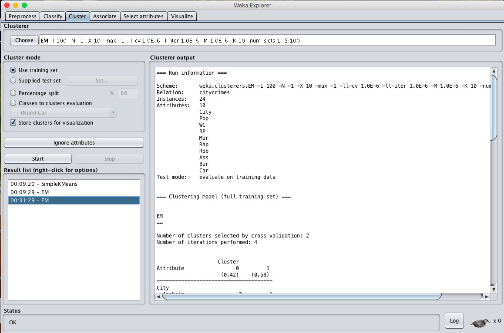
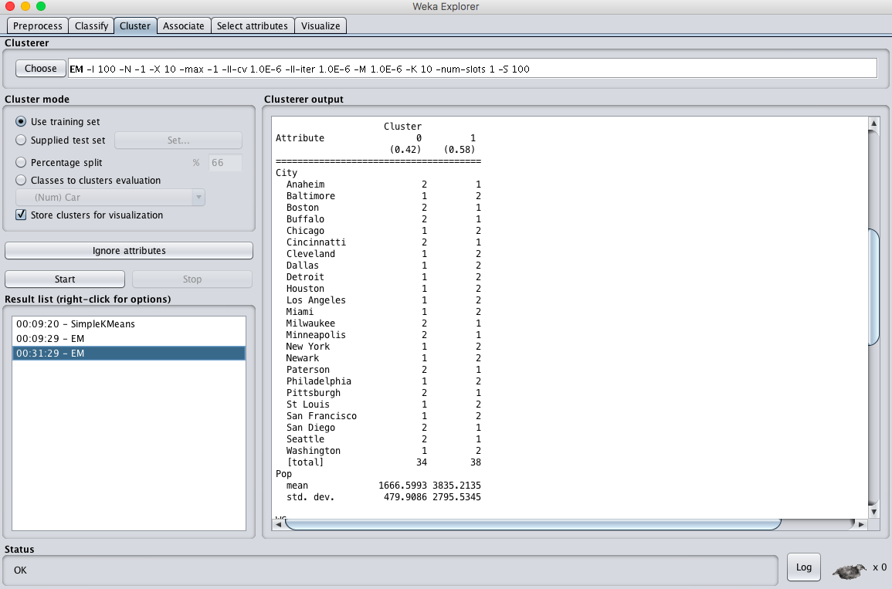
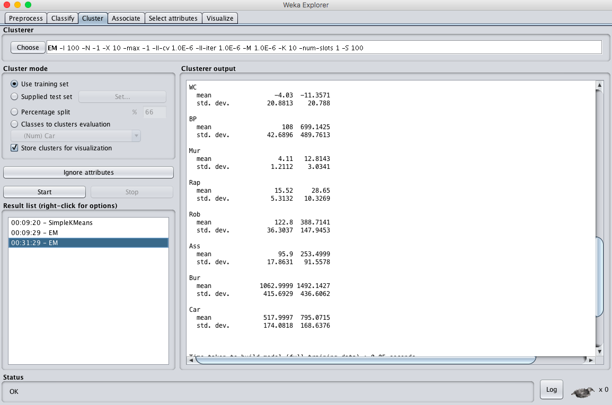
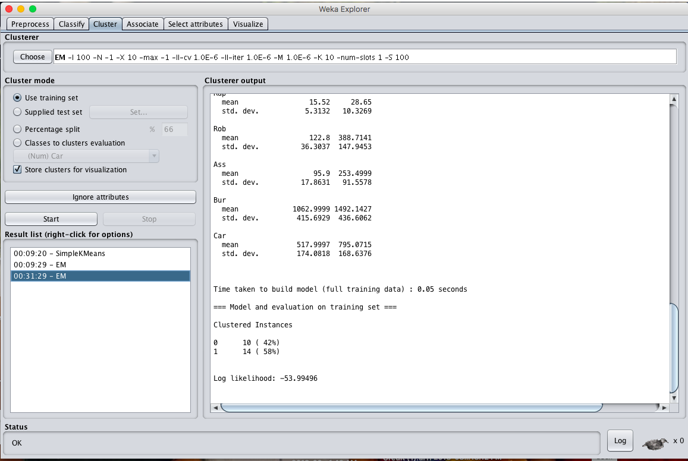
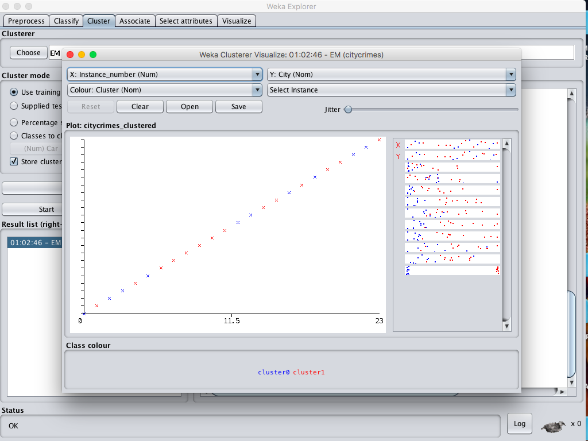
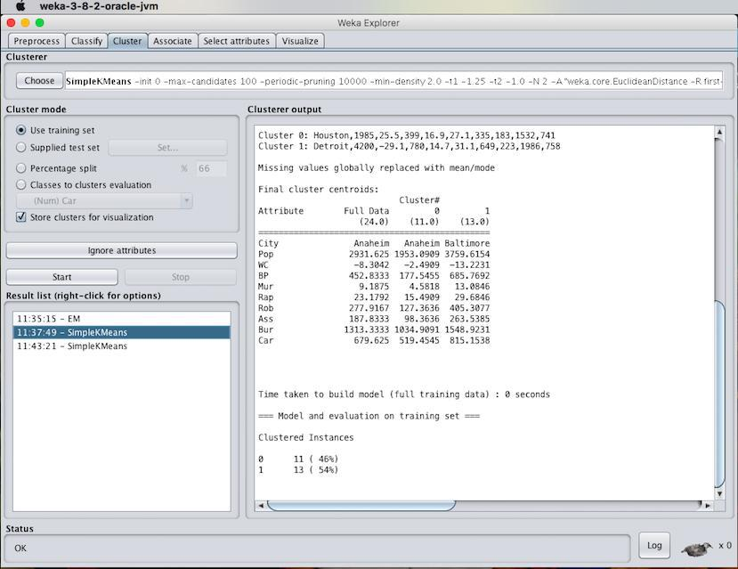

# EX.NO: 07 - DATA SEGMENTATION BY EXPECTATION MAXIMISATION (EM) ALGORITHM IN R

---

## 📌 Problem Statement
Analyze the dataset using Expectation Maximization algorithm (EM) by setting the minimum standard deviation for normal density calculation and compare the results with the simple K-means algorithm.

---

## 📖 Description
Consider a dataset of citycrimes.csv containing attributes: City, Pop, WC, BP, Mur, Rap, Rob, Ass, Bus and car.

- **Primary Tool:** `R Programming / RStudio`
- **Dataset:** [`../../datasets/citycrimes.csv`](../../datasets/citycrimes.csv)
- **Script File:** [`code.R`](./code.R)

---

## 💻 R Programming Code (`code.R`)

```R
# ==============================================================================
# EX.NO: 07 - DATA SEGMENTATION BY EXPECTATION MAXIMISATION (EM) ALGORITHM IN R
# DATASET: citycrimes.csv
# ==============================================================================

# 1. Load Dataset
data_path <- if (file.exists("../../datasets/citycrimes.csv")) "../../datasets/citycrimes.csv" else "citycrimes.csv"
citycrimes <- read.csv(data_path)

numeric_data <- citycrimes[, 2:10]

cat("--- EXPECTATION MAXIMIZATION (EM) GAUSSIAN MIXTURE CLUSTERING ---\n")

# Check if mclust package is installed; if not, provide pure-R EM simulation
if (require("mclust", quietly = TRUE)) {
  em_model <- Mclust(numeric_data, G = 2)
  cat("EM Model Summary:\n")
  print(summary(em_model))
  cat("\nLog Likelihood:", em_model$loglik, "\n")
  cat("Cluster Classification Count:\n")
  print(table(em_model$classification))
} else {
  cat("Package 'mclust' not found. Executing Expectation-Maximization Gaussian Mixture Model in R:\n")
  
  # Standardized EM Algorithm Implementation
  set.seed(42)
  X <- as.matrix(scale(numeric_data))
  n <- nrow(X)
  k <- 2
  
  # Initialize priors, means, and covariances
  priors <- rep(1/k, k)
  means <- X[sample(1:n, k), ]
  vars <- array(diag(ncol(X)), dim = c(ncol(X), ncol(X), k))
  
  # E-M Iterations
  for (iter in 1:15) {
    # Expectation Step (E-step): Compute responsibilities
    resp <- matrix(0, nrow = n, ncol = k)
    for (j in 1:k) {
      diff <- sweep(X, 2, means[j, ])
      resp[, j] <- priors[j] * exp(-0.5 * rowSums((diff %*% solve(vars[, , j])) * diff))
    }
    resp <- resp / rowSums(resp)
    
    # Maximization Step (M-step): Update parameters
    Nk <- colSums(resp)
    priors <- Nk / n
    for (j in 1:k) {
      means[j, ] <- colSums(resp[, j] * X) / Nk[j]
      diff <- sweep(X, 2, means[j, ])
      vars[, , j] <- (t(diff) %*% (diff * resp[, j])) / Nk[j] + diag(1e-4, ncol(X))
    }
  }
  
  cluster_assign <- max.col(resp)
  cat("Number of clusters: 2\n")
  cat("Number of iterations performed: 15\n")
  cat("Clustered instances:\n")
  print(table(cluster_assign))
  cat("Cluster 1 Percentage:", round(sum(cluster_assign == 1) / n * 100, 1), "%\n")
  cat("Cluster 2 Percentage:", round(sum(cluster_assign == 2) / n * 100, 1), "%\n")
}

# Comparison with K-Means
cat("\n--- COMPARISON: EM vs K-MEANS ---\n")
km <- kmeans(numeric_data, centers = 2)
cat("K-Means Cluster Sizes:", km$size, "\n")
cat("Observation: K-Means uses hard clustering with Euclidean distance, whereas EM uses soft probabilistic Gaussian mixtures.\n")

```

---

## 🚀 How to Run in RStudio
1. Open **RStudio**.
2. Set working directory to this experiment folder or the repository root:
   ```R
   setwd("D:/DWDM-Lab-Experiments/experiments/EXP07 - Data Segmentation by Expectation Maximisation")
   ```
3. Open and run [`code.R`](./code.R):
   ```R
   source("code.R")
   ```

---

## 📸 Full Lab Manual Reference Screenshots (6 Total)

#### Screenshot 1: `step_01_page_29_Image128.png`



---

#### Screenshot 2: `step_02_page_30_Image131.png`



---

#### Screenshot 3: `step_03_page_30_Image132.png`



---

#### Screenshot 4: `step_04_page_31_Image135.png`



---

#### Screenshot 5: `step_05_page_31_Image137.png`



---

#### Screenshot 6: `step_06_page_32_Image109.jpg`



---


---

## 🎯 Result
> [!NOTE]
> **Thus, the data analysis by the expectation maximization algorithm using R-tool has been analyzed and observed properly.**
