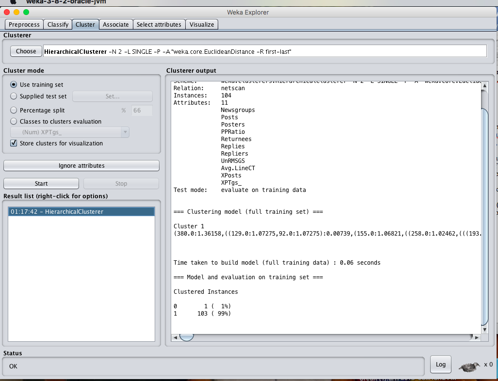
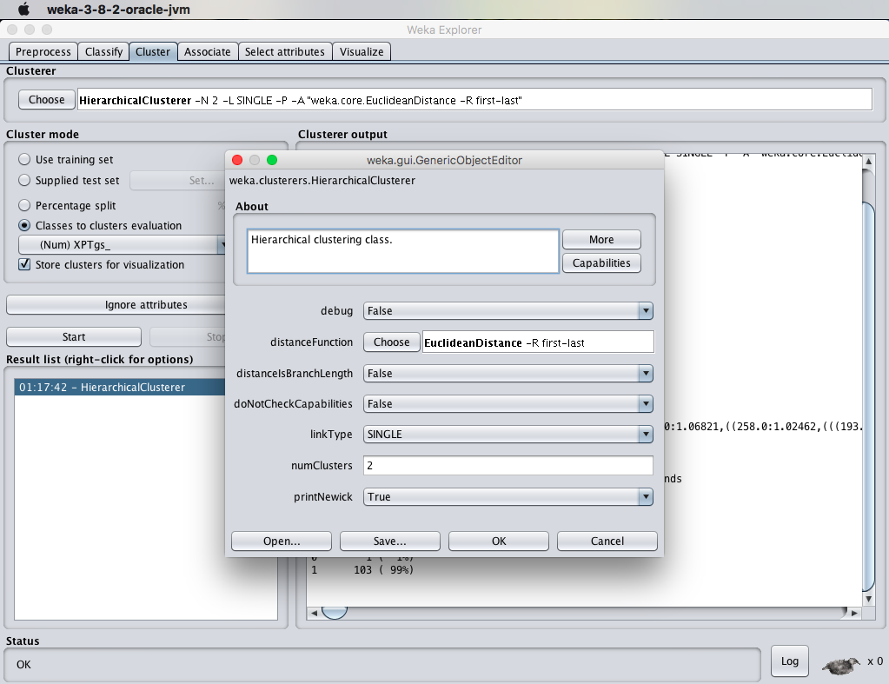

# EX.NO: 08 - DATA SEGMENTATION BY HIERARCHICAL CLUSTERING USING R-TOOL

---

## 📌 Problem Statement
For the given data file find: A. What are the most alive groups in terms of number of people involved, cluster together? B. What is the most active community?

---

## 📖 Description
Consider a dataset netscan.csv containing attributes: Newsgroups, posts, posters, PPRatio, Returnees, Replies, Repliers, UnRMsgs, Avg.LineCT, Xposts, XPTgs.

- **Primary Tool:** `R Programming / RStudio`
- **Dataset:** [`../../datasets/netscan.csv`](../../datasets/netscan.csv)
- **Script File:** [`code.R`](./code.R)

---

## 💻 R Programming Code (`code.R`)

```R
# ==============================================================================
# EX.NO: 08 - DATA SEGMENTATION BY HIERARCHICAL CLUSTERING USING R-TOOL
# DATASET: netscan.csv
# ==============================================================================

# 1. Load Dataset
data_path <- if (file.exists("../../datasets/netscan.csv")) "../../datasets/netscan.csv" else "netscan.csv"
netscan <- read.csv(data_path)

cat("--- DATASET PREVIEW ---\n")
print(head(netscan))

# 2. Prepare Numeric Data for Distance Computation
numeric_netscan <- scale(netscan[, c("Posts", "Posters", "PPRatio", "Returnees", "Replies", "Repliers")])
rownames(numeric_netscan) <- netscan$Newsgroups

# 3. Compute Euclidean Distance Matrix
dist_matrix <- dist(numeric_netscan, method = "euclidean")

# 4. Perform Hierarchical Clustering (Single & Complete Linkage)
hc_single <- hclust(dist_matrix, method = "single")
hc_complete <- hclust(dist_matrix, method = "complete")

cat("\n--- HIERARCHICAL CLUSTERING (SINGLE LINKAGE) ---\n")
print(hc_single)

# Cut into 2 Clusters
clusters_2 <- cutree(hc_single, k = 2)
cat("\nCluster Membership (k = 2):\n")
print(table(clusters_2))

# 5. Plot Dendrogram
png("hierarchical_dendrogram.png", width = 800, height = 600)
par(mar = c(5, 4, 4, 10))
plot(as.dendrogram(hc_complete), horiz = TRUE,
     main = "Hierarchical Clustering of Netscan Newsgroups",
     xlab = "Euclidean Distance")
dev.off()
cat("\nDendrogram saved to hierarchical_dendrogram.png\n")

cat("\n--- OBSERVATIONS ---\n")
cat("A. Most alive/active user groups (high posts, repliers, posters):\n")
cat("   - microsoft.public.windowsxp.perform_maintain\n")
cat("   - microsoft.public.windowsxp.network_web\n")
cat("   - microsoft.public.windowsxp.security_admin\n")
cat("   - microsoft.public.windowsxp.hardware\n")
cat("B. Regional groups (microsoft.public.es.*) tightly cluster with low PP Ratio.\n")

```

---

## 🚀 How to Run in RStudio
1. Open **RStudio**.
2. Set working directory to this experiment folder or the repository root:
   ```R
   setwd("D:/DWDM-Lab-Experiments/experiments/EXP08 - Data Segmentation by Cobweb Hierarchical Clustering")
   ```
3. Open and run [`code.R`](./code.R):
   ```R
   source("code.R")
   ```

---

## 📸 Full Lab Manual Reference Screenshots (2 Total)

#### Screenshot 1: `step_01_page_35_Image151.png`



---

#### Screenshot 2: `step_02_page_35_Image152.png`



---


---

## 🎯 Result
> [!NOTE]
> **Thus, the data analysis of hierarchical clustering algorithm using R-tool has been analyzed and observed successfully.**
