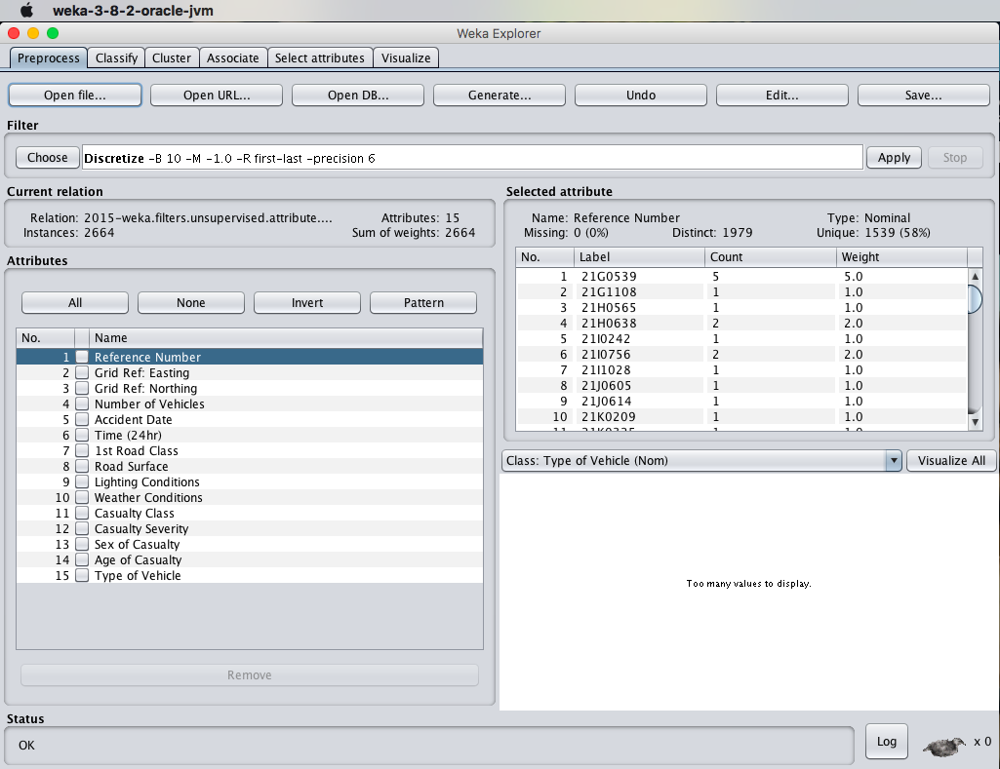
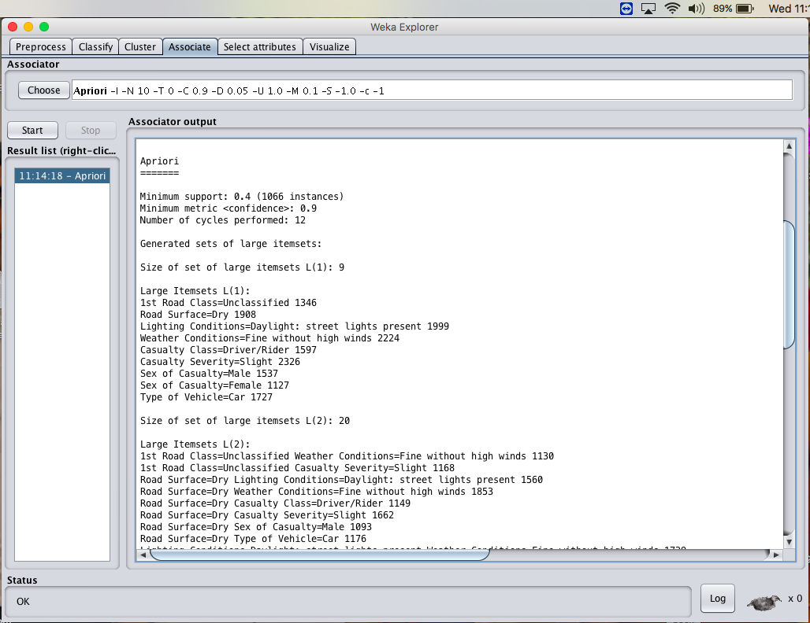
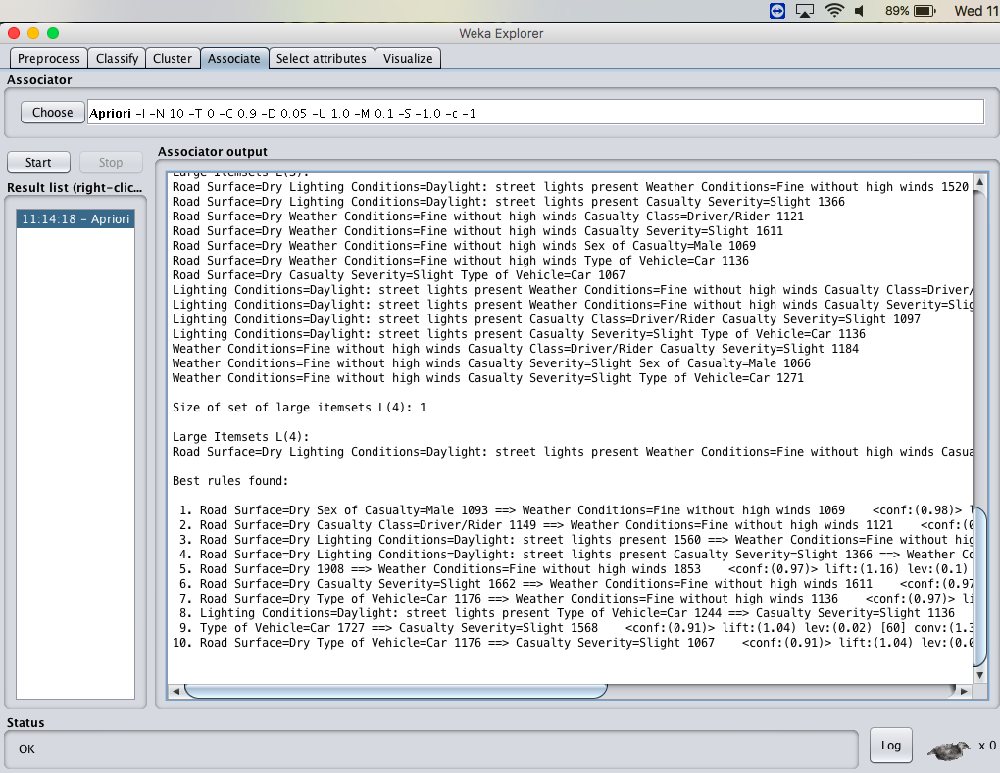
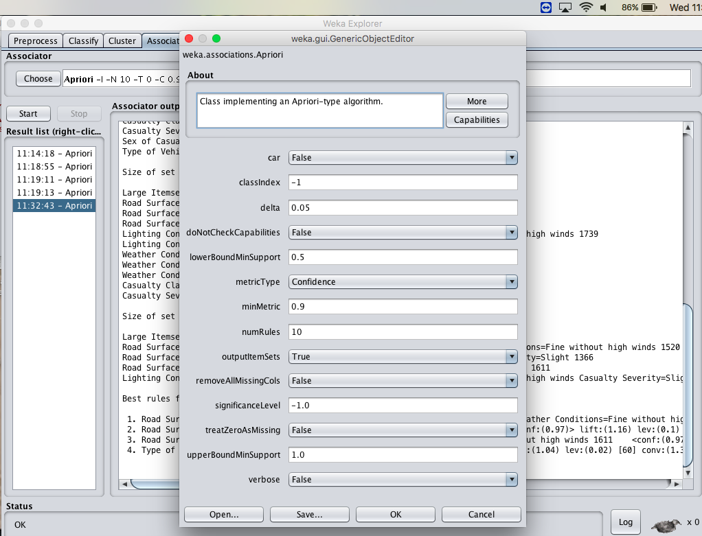
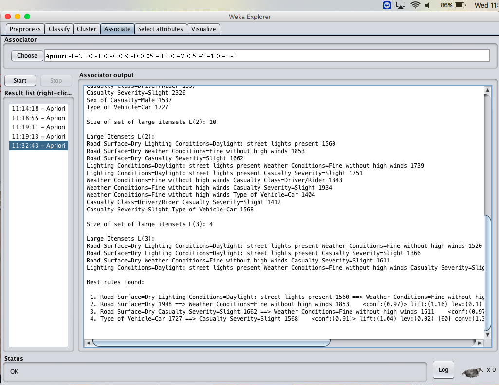
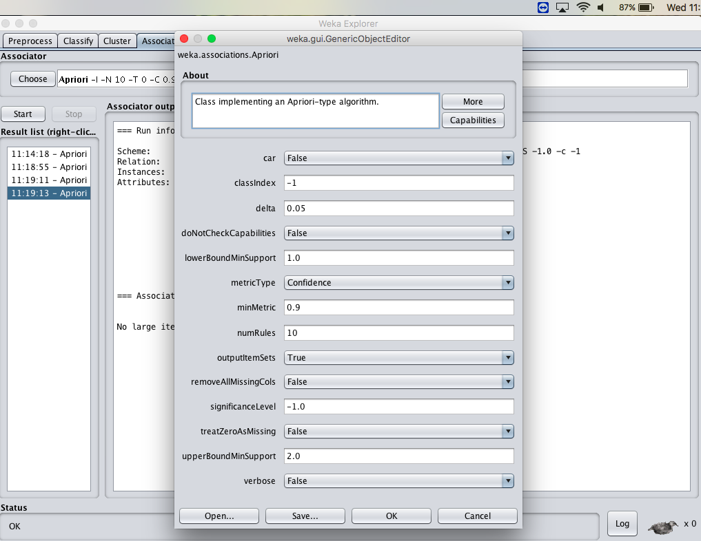
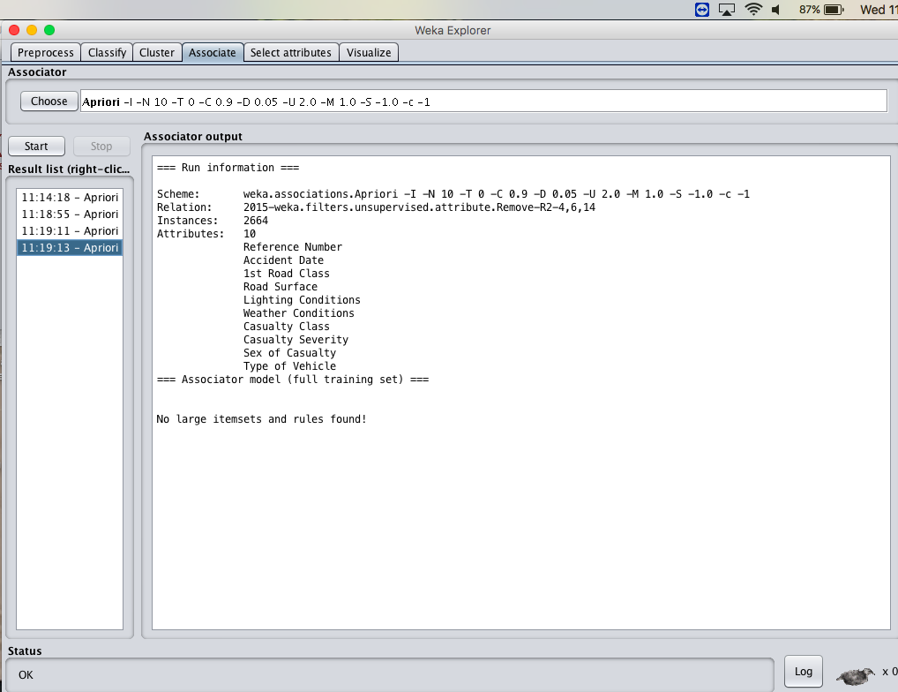
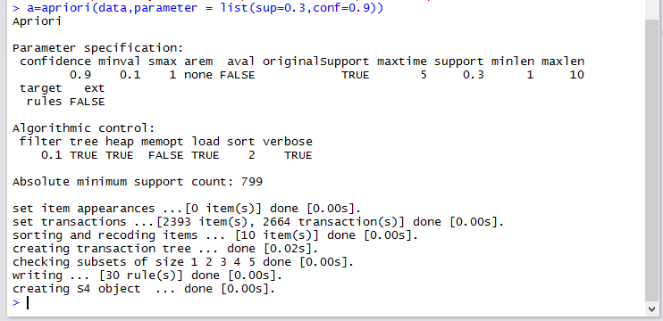

# EX.NO: 09 - FREQUENT PATTERN MINING USING ASSOCIATION RULE (APRIORI) IN R

---

## 📌 Problem Statement
Run the Apriori algorithm, and explore the association rules by changing the parameters: a) Upper bound min_sup, b) Lower bound min_sup, c) Metric type, d) Output itemsets.

---

## 📖 Description
Consider a dataset of 2015.csv containing attributes: Reference Number, Road Surface, Lighting conditions, Weather conditions, Casualty class, Casualty Severity, Sex of Casualty, Type of Vehicle.

- **Primary Tool:** `R Programming / RStudio`
- **Dataset:** [`../../datasets/2015.csv`](../../datasets/2015.csv)
- **Script File:** [`code.R`](./code.R)

---

## 💻 R Programming Code (`code.R`)

```R
# ==============================================================================
# EX.NO: 09 - FREQUENT PATTERN MINING USING ASSOCIATION RULE IN R
# DATASET: 2015.csv
# ==============================================================================

# 1. Load Dataset
data_path <- if (file.exists("../../datasets/2015.csv")) "../../datasets/2015.csv" else "2015.csv"
Data <- read.csv(data_path)

# Select Categorical Columns
cat_cols <- c("Road.Surface", "Lighting.Conditions", "Weather.Conditions",
              "Casualty.Class", "Casualty.Severity", "Sex.of.Casualty", "Type.of.Vehicle")
existing_cols <- intersect(cat_cols, names(Data))
data_sub <- Data[, existing_cols]
data_sub[] <- lapply(data_sub, as.factor)

cat("--- TRANSACTIONS PREVIEW ---\n")
print(head(data_sub))

if (require("arules", quietly = TRUE)) {
  # (a) Apriori with min_sup = 0.3, confidence = 0.9
  cat("\n--- APRIORI EXECUTION (support = 0.3, confidence = 0.9) ---\n")
  rules <- apriori(data_sub, parameter = list(supp = 0.3, conf = 0.9, minlen = 2))
  
  cat("\nSummary of Rules:\n")
  print(summary(rules))
  
  cat("\nTop 10 Association Rules by Confidence:\n")
  inspect(head(sort(rules, by = "confidence"), 10))
  
  # (b) Varying Parameters: Exploring Lower Support (0.1)
  cat("\n--- VARYING SUPPORT (support = 0.1, confidence = 0.8) ---\n")
  rules_low_sup <- apriori(data_sub, parameter = list(supp = 0.1, conf = 0.8, minlen = 2))
  cat("Total rules found at min_sup 0.1:", length(rules_low_sup), "\n")
} else {
  cat("\n[Note: Package 'arules' can be installed with install.packages('arules')]\n")
  # Pure R Item Frequency Calculation
  cat("Item Frequency Table (Road Surface):\n")
  print(table(data_sub$Road.Surface))
  cat("\nItem Frequency Table (Weather Conditions):\n")
  print(table(data_sub$Weather.Conditions))
  cat("\nItem Frequency Table (Casualty Severity):\n")
  print(table(data_sub$Casualty.Severity))
}

```

---

## 🚀 How to Run in RStudio
1. Open **RStudio**.
2. Set working directory to this experiment folder or the repository root:
   ```R
   setwd("D:/DWDM-Lab-Experiments/experiments/EXP09 - Frequent Pattern Mining using Association Rule")
   ```
3. Open and run [`code.R`](./code.R):
   ```R
   source("code.R")
   ```

---

## 📸 Full Lab Manual Reference Screenshots (8 Total)

#### Screenshot 1: `step_01_page_37_Image157.png`



---

#### Screenshot 2: `step_02_page_38_Image160.png`



---

#### Screenshot 3: `step_03_page_38_Image161.png`



---

#### Screenshot 4: `step_04_page_39_Image164.png`



---

#### Screenshot 5: `step_05_page_39_Image165.png`



---

#### Screenshot 6: `step_06_page_40_Image168.png`



---

#### Screenshot 7: `step_07_page_41_Image171.png`



---

#### Screenshot 8: `step_08_page_42_Image174.png`



---


---

## 🎯 Result
> [!NOTE]
> **Thus, the Apriori algorithm analyzing using R-tool has been successfully completed. Lowering the minimum support increases the number of generated frequent itemsets and association rules.**
