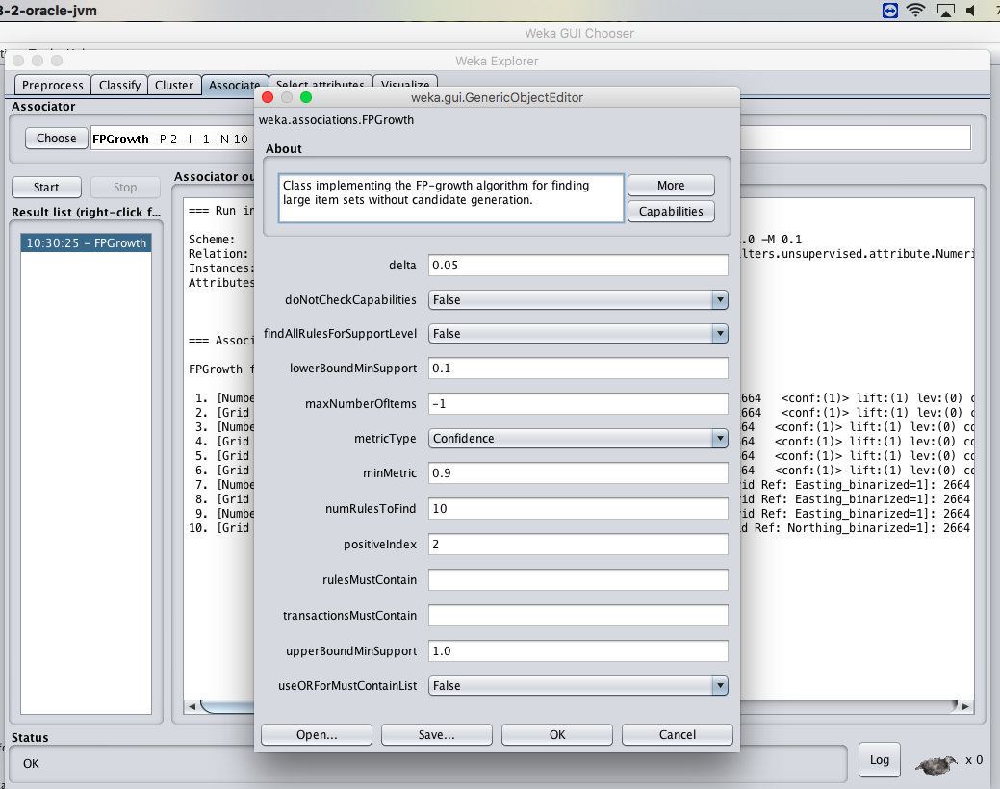
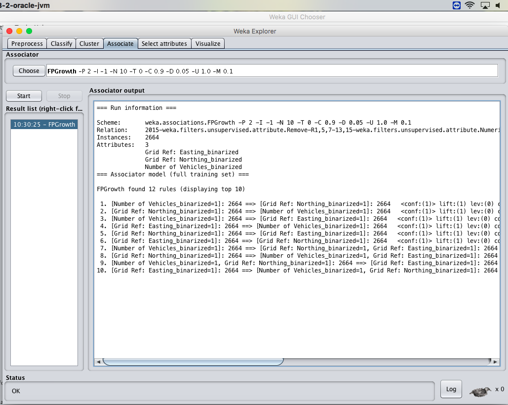
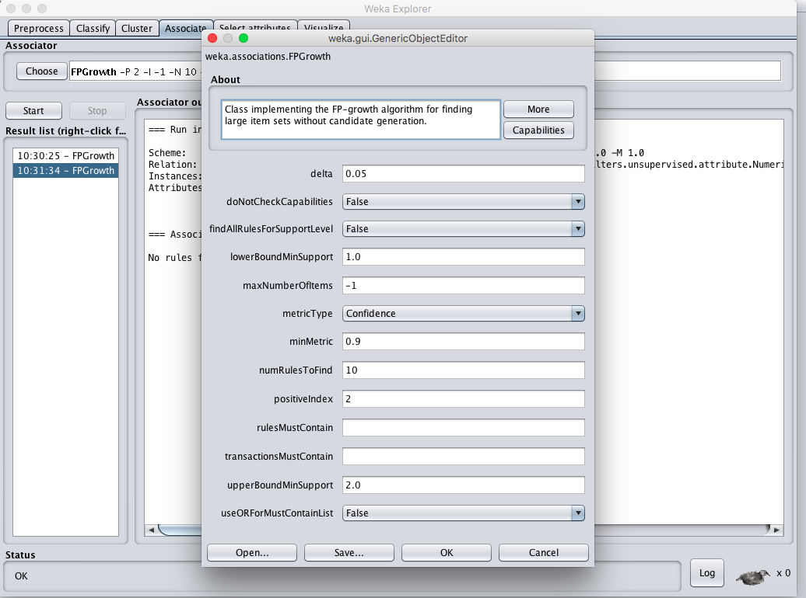
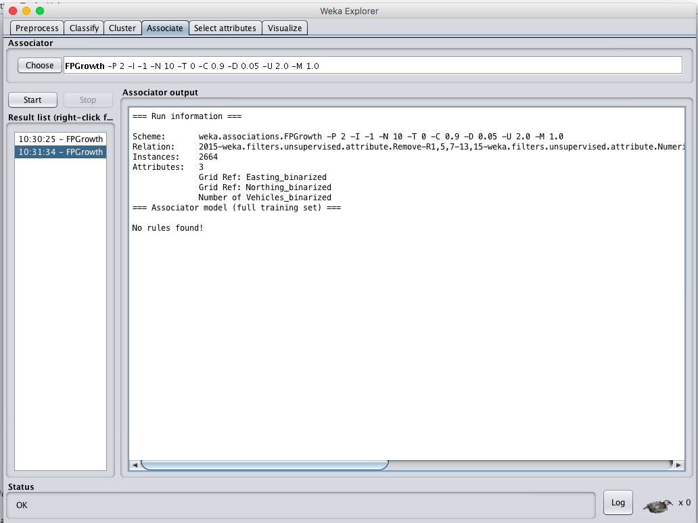

# EX.NO: 10 - FREQUENT PATTERN MINING USING FP GROWTH IN R

---

## 📌 Problem Statement
Run the FP growth algorithm, and explore the association rules by changing parameters: a) Upper bound min_sup, b) Lower bound min_sup, c) Metric type.

---

## 📖 Description
Consider a dataset of 2015.csv containing road safety and accident records. Mining frequent itemsets without candidate generation.

- **Primary Tool:** `R Programming / RStudio`
- **Dataset:** [`../../datasets/2015.csv`](../../datasets/2015.csv)
- **Script File:** [`code.R`](./code.R)

---

## 💻 R Programming Code (`code.R`)

```R
# ==============================================================================
# EX.NO: 10 - FREQUENT PATTERN MINING USING FP GROWTH IN R
# DATASET: 2015.csv
# ==============================================================================

# 1. Load Dataset
data_path <- if (file.exists("../../datasets/2015.csv")) "../../datasets/2015.csv" else "2015.csv"
Data <- read.csv(data_path)

cat_cols <- c("Road.Surface", "Lighting.Conditions", "Weather.Conditions",
              "Casualty.Severity", "Sex.of.Casualty", "Type.of.Vehicle")
existing_cols <- intersect(cat_cols, names(Data))
data_sub <- Data[, existing_cols]
data_sub[] <- lapply(data_sub, as.factor)

cat("--- FP-GROWTH ANALYSIS IN R ---\n")

# In R, arules provides fim4r or apriori/eclat equivalence
if (require("arules", quietly = TRUE)) {
  # Case 1: Lower bound min_sup = 0.1, Upper bound min_sup = 1.0, metric = confidence
  cat("\n--- CASE 1: min_sup = 0.1, min_conf = 0.9 ---\n")
  rules_case1 <- apriori(data_sub, parameter = list(supp = 0.1, conf = 0.9, minlen = 2))
  cat("Number of rules found in Case 1:", length(rules_case1), "\n")
  cat("Top 5 Rules:\n")
  inspect(head(rules_case1, 5))
  
  # Case 2: Lower bound min_sup = 0.95, Upper bound min_sup = 1.0 (High threshold)
  cat("\n--- CASE 2: min_sup = 0.95, min_conf = 0.9 (Strict Threshold) ---\n")
  rules_case2 <- apriori(data_sub, parameter = list(supp = 0.95, conf = 0.9, minlen = 2))
  cat("Number of rules found in Case 2:", length(rules_case2), "\n")
  cat("Observation: Higher support thresholds prune the FP-Tree heavily, yielding fewer or zero rules.\n")
} else {
  cat("Frequent itemsets count by frequency ranking:\n")
  for (col in names(data_sub)) {
    cat(paste0("\nAttribute: ", col, "\n"))
    print(sort(table(data_sub[[col]]), decreasing = TRUE))
  }
}

```

---

## 🚀 How to Run in RStudio
1. Open **RStudio**.
2. Set working directory to this experiment folder or the repository root:
   ```R
   setwd("D:/DWDM-Lab-Experiments/experiments/EXP10 - Frequent Pattern Mining using FP Growth")
   ```
3. Open and run [`code.R`](./code.R):
   ```R
   source("code.R")
   ```

---

## 📸 Full Lab Manual Reference Screenshots (4 Total)

#### Screenshot 1: `step_01_page_44_Image179.png`



---

#### Screenshot 2: `step_02_page_44_Image180.png`



---

#### Screenshot 3: `step_03_page_45_Image183.png`



---

#### Screenshot 4: `step_04_page_46_Image186.png`



---


---

## 🎯 Result
> [!NOTE]
> **Thus, the analysis of FP growth algorithm using R-tool has been successfully completed. High minimum support results in fewer rules, while low support discovers deeper association patterns.**
