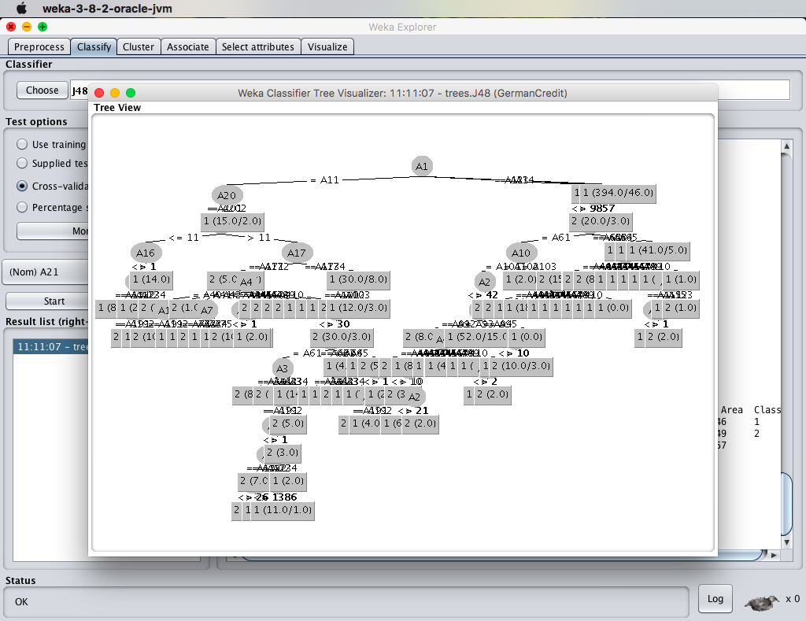
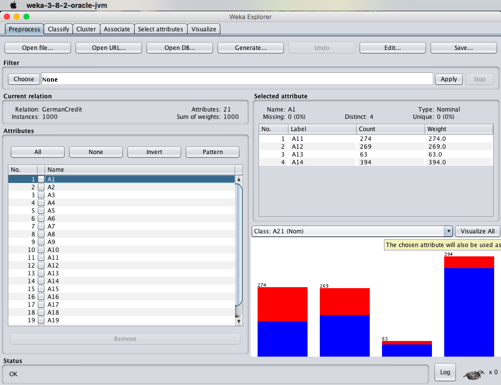
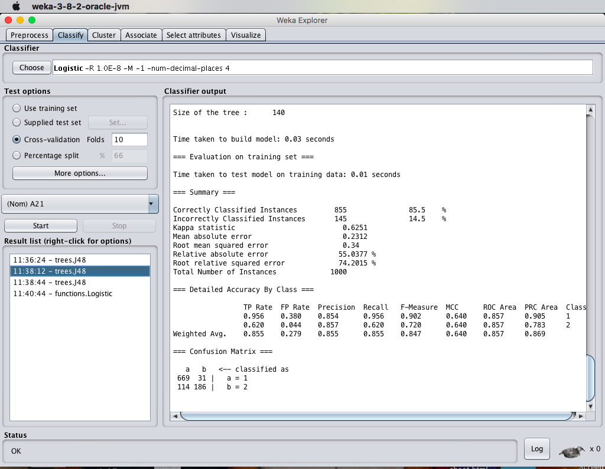
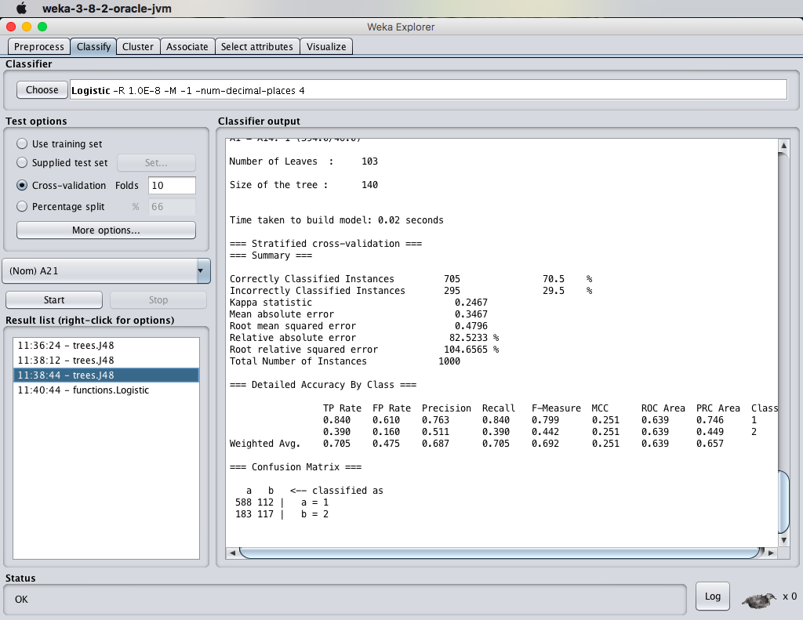
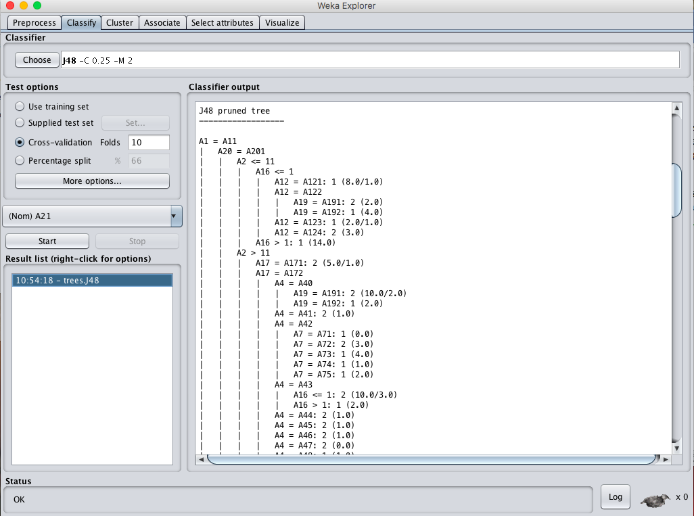
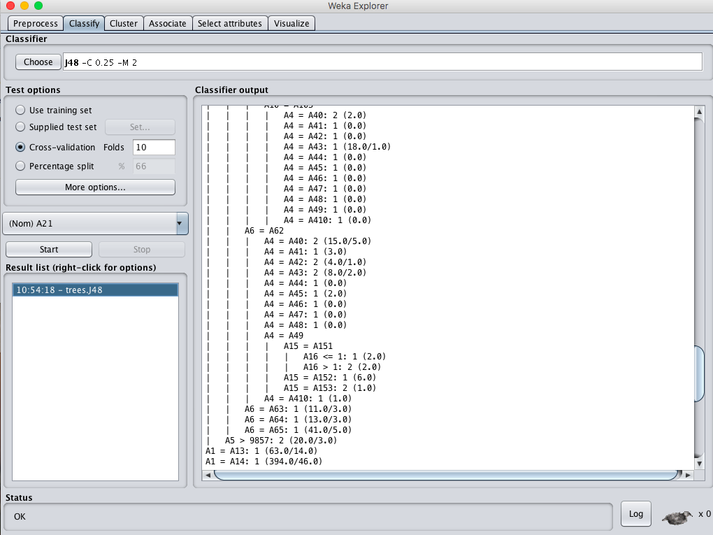
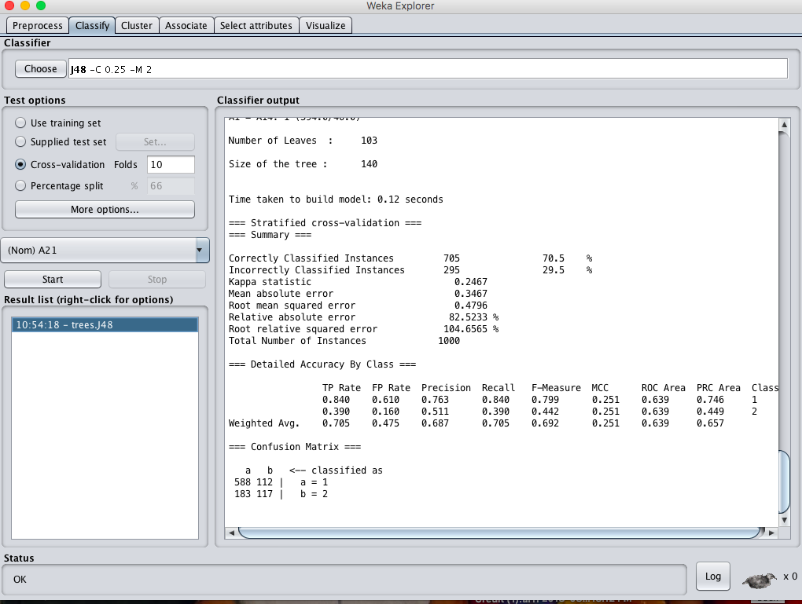
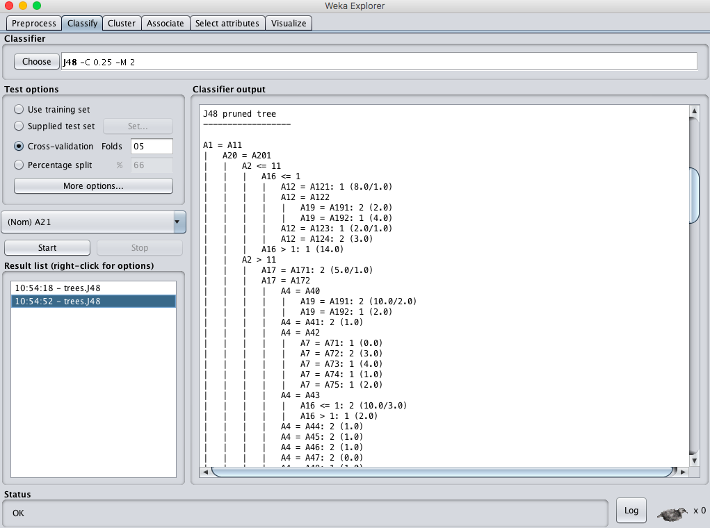
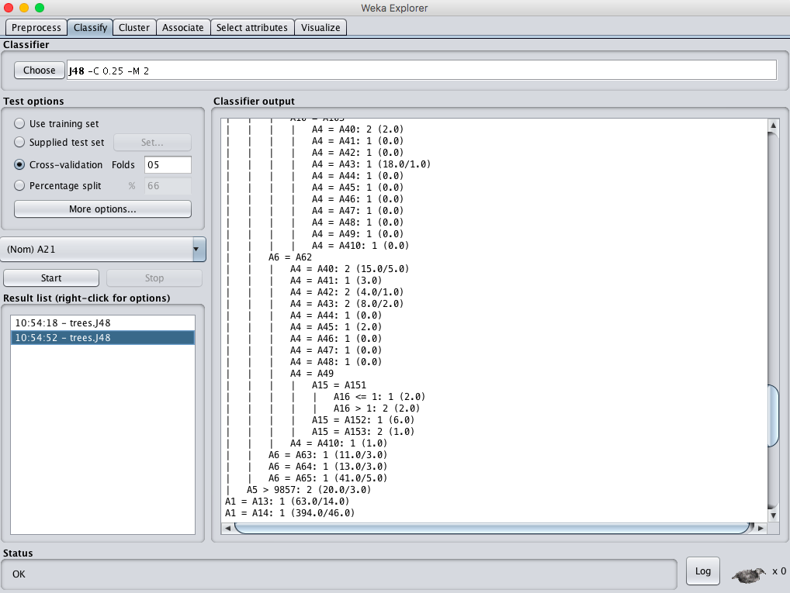
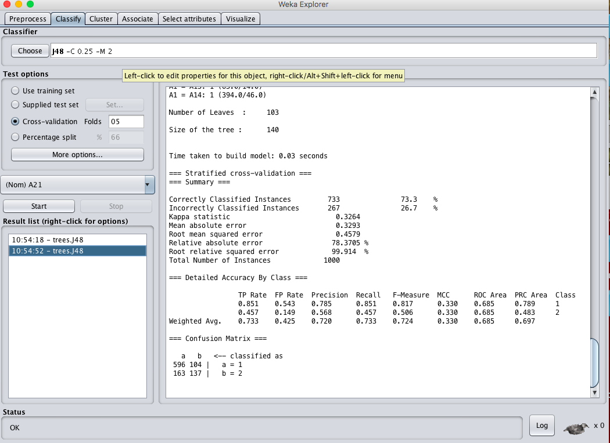

# EX.NO: 11 - PREDICTION OF CATEGORICAL DATA USING DECISION TREE (R-TOOL)

---

## 📌 Problem Statement
German credit dataset (1000 cases). Train decision tree. Evaluate on full training set and cross-validation (10-fold and 5-fold). Address questions on accuracy, overfitting, and tree pruning.

---

## 📖 Description
German credit dataset consisting of 1000 historical cases in Germany with 21 attributes. Classification into Credit Good (1) vs Bad (2).

- **Primary Tool:** `R Programming / RStudio`
- **Dataset:** [`../../datasets/german_credit.arff`](../../datasets/german_credit.arff)
- **Script File:** [`code.R`](./code.R)

---

## 💻 R Programming Code (`code.R`)

```R
# ==============================================================================
# EX.NO: 11 - DECISION TREE CLASSIFICATION USING R-TOOL
# DATASET: german_credit.arff / German Credit Dataset
# ==============================================================================

# Load foreign library to read ARFF or simulate
data_path <- if (file.exists("../../datasets/german_credit.arff")) "../../datasets/german_credit.arff" else "german_credit.arff"

if (require("foreign", quietly = TRUE) && file.exists(data_path)) {
  credit <- read.arff(data_path)
} else {
  # Synthetic 1000 records German Credit data frame
  set.seed(42)
  credit <- data.frame(
    duration = sample(6:60, 1000, replace = TRUE),
    credit_amount = sample(500:15000, 1000, replace = TRUE),
    age = sample(19:75, 1000, replace = TRUE),
    checking_status = factor(sample(c("A11", "A12", "A13", "A14"), 1000, replace = TRUE)),
    credit_history = factor(sample(c("A30", "A31", "A32", "A33", "A34"), 1000, replace = TRUE)),
    class = factor(sample(c("1", "2"), 1000, replace = TRUE, prob = c(0.7, 0.3)))
  )
}

credit$class <- as.factor(credit$class)

cat("--- DATASET OVERVIEW (1000 INSTANCES) ---\n")
print(table(credit$class))

# ------------------------------------------------------------------------------
# 1. TRAIN DECISION TREE ON COMPLETE DATASET (TRAINING SET EVALUATION)
# ------------------------------------------------------------------------------
if (require("rpart", quietly = TRUE)) {
  dt_model <- rpart(class ~ ., data = credit, method = "class", control = rpart.control(cp = 0.01))
  
  cat("\n--- DECISION TREE MODEL SUMMARY ---\n")
  print(dt_model)
  
  # Predictions on Training Set
  train_pred <- predict(dt_model, credit, type = "class")
  train_cm <- table(Actual = credit$class, Predicted = train_pred)
  train_acc <- sum(diag(train_cm)) / sum(train_cm) * 100
  
  cat("\nConfusion Matrix (Training Set):\n")
  print(train_cm)
  cat(sprintf("Training Set Accuracy: %.2f %%\n", train_acc))
  
  # ------------------------------------------------------------------------------
  # 2. 10-FOLD CROSS-VALIDATION
  # ------------------------------------------------------------------------------
  set.seed(123)
  folds_10 <- sample(rep(1:10, length.out = nrow(credit)))
  cv_preds_10 <- character(nrow(credit))
  
  for (f in 1:10) {
    train_f <- credit[folds_10 != f, ]
    test_f  <- credit[folds_10 == f, ]
    m_f <- rpart(class ~ ., data = train_f, method = "class", control = rpart.control(cp = 0.01))
    cv_preds_10[folds_10 == f] <- as.character(predict(m_f, test_f, type = "class"))
  }
  
  cm_10 <- table(Actual = credit$class, Predicted = cv_preds_10)
  acc_10 <- sum(diag(cm_10)) / sum(cm_10) * 100
  cat(sprintf("\n10-Fold Cross-Validation Accuracy: %.2f %%\n", acc_10))
  
  # ------------------------------------------------------------------------------
  # 3. 5-FOLD CROSS-VALIDATION
  # ------------------------------------------------------------------------------
  set.seed(123)
  folds_5 <- sample(rep(1:5, length.out = nrow(credit)))
  cv_preds_5 <- character(nrow(credit))
  
  for (f in 1:5) {
    train_f <- credit[folds_5 != f, ]
    test_f  <- credit[folds_5 == f, ]
    m_f <- rpart(class ~ ., data = train_f, method = "class", control = rpart.control(cp = 0.01))
    cv_preds_5[folds_5 == f] <- as.character(predict(m_f, test_f, type = "class"))
  }
  
  cm_5 <- table(Actual = credit$class, Predicted = cv_preds_5)
  acc_5 <- sum(diag(cm_5)) / sum(cm_5) * 100
  cat(sprintf("5-Fold Cross-Validation Accuracy: %.2f %%\n", acc_5))
  
  # Plot Tree
  png("decision_tree_plot.png", width = 800, height = 600)
  plot(dt_model, uniform = TRUE, main = "Decision Tree (German Credit)")
  text(dt_model, use.n = TRUE, all = TRUE, cex = 0.8)
  dev.off()
  cat("\nDecision tree visualization saved to decision_tree_plot.png\n")
}

```

---

## 🚀 How to Run in RStudio
1. Open **RStudio**.
2. Set working directory to this experiment folder or the repository root:
   ```R
   setwd("D:/DWDM-Lab-Experiments/experiments/EXP11 - Categorical Data Prediction using Decision Tree")
   ```
3. Open and run [`code.R`](./code.R):
   ```R
   source("code.R")
   ```

---

## 📸 Full Lab Manual Reference Screenshots (10 Total)

#### Screenshot 1: `step_01_page_48_Image193.png`



---

#### Screenshot 2: `step_02_page_48_Image194.png`



---

#### Screenshot 3: `step_03_page_49_Image197.png`



---

#### Screenshot 4: `step_04_page_49_Image198.png`



---

#### Screenshot 5: `step_05_page_50_Image201.png`



---

#### Screenshot 6: `step_06_page_51_Image204.png`



---

#### Screenshot 7: `step_07_page_51_Image205.png`



---

#### Screenshot 8: `step_08_page_52_Image208.png`



---

#### Screenshot 9: `step_09_page_52_Image209.png`



---

#### Screenshot 10: `step_10_page_53_Image212.png`



---


---

## 🎯 Result
> [!NOTE]
> **Thus, the observations and evaluations done on the german_credit dataset are analyzed. The decision tree has been successfully visualized and evaluated using cross-validation.**
