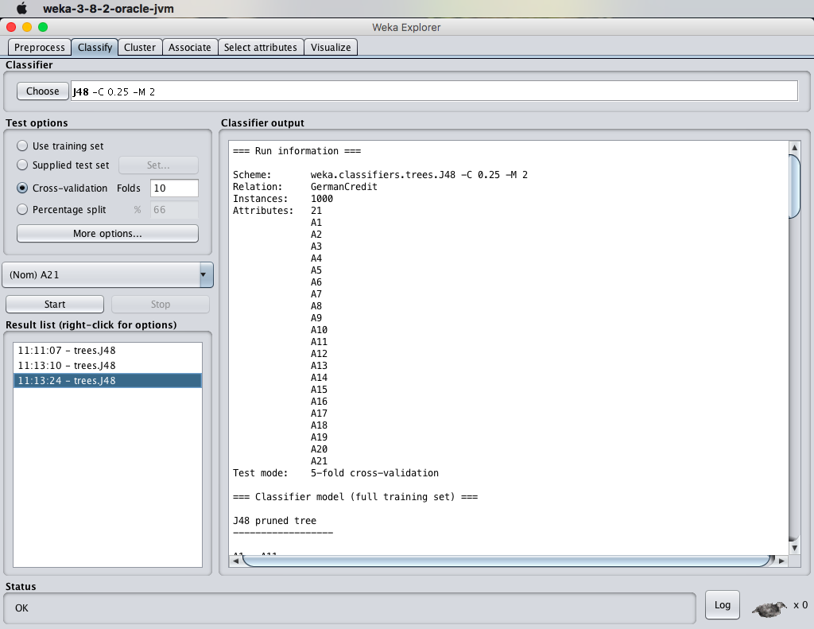
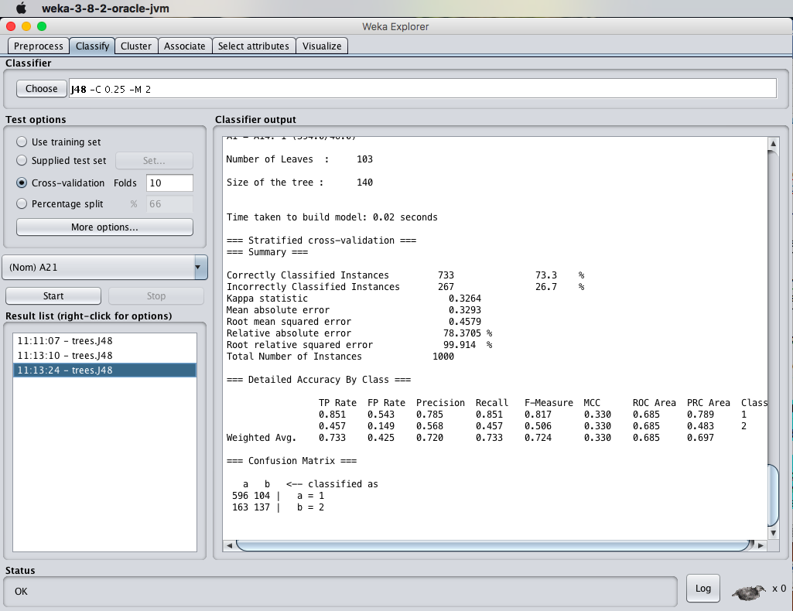
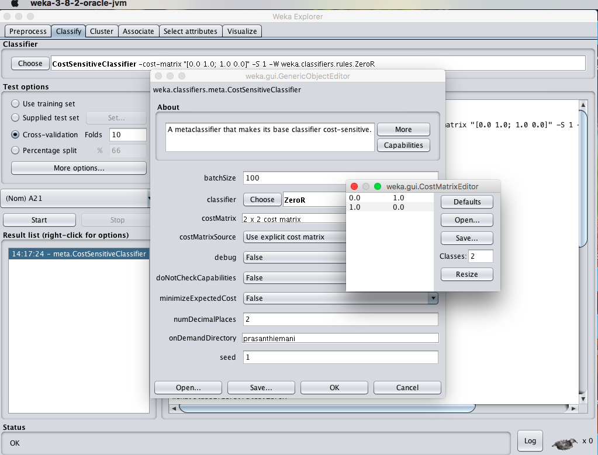
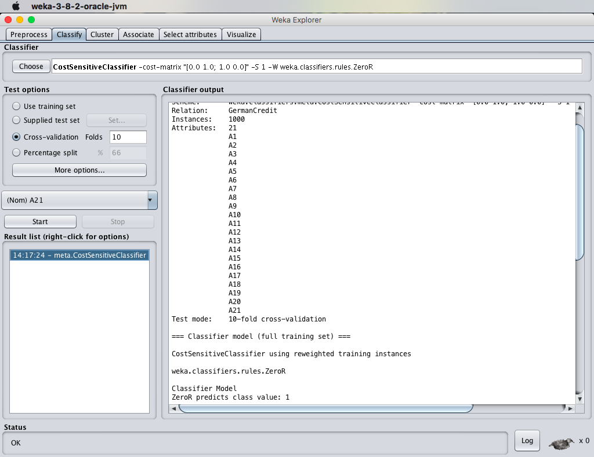
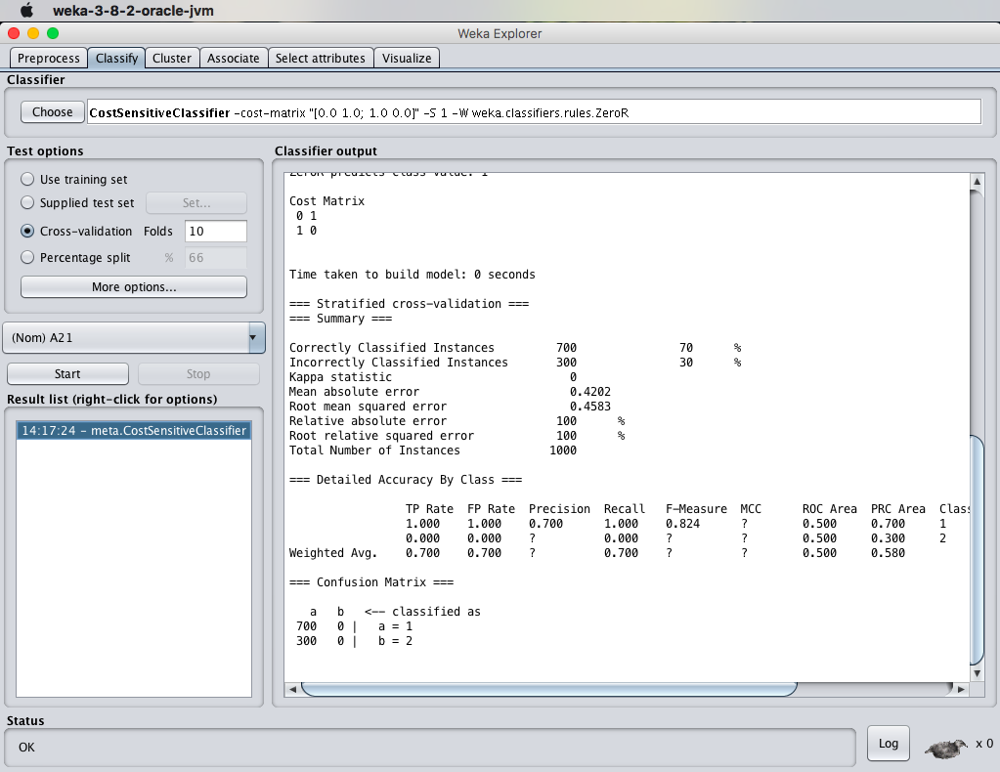

# EX.NO: 12 - PREDICTION OF CATEGORICAL DATA USING SMO / SVM (R-TOOL)

---

## 📌 Problem Statement
Use German credit dataset. 1. Compare Decision Tree vs SMO. 2. Set cost sensitive evaluation (2x2 cost matrix). 3. Examine MAE, RMSE, RAE, and Total instances.

---

## 📖 Description
Sequential Minimal Optimization (SMO) algorithm solving quadratic programming for Support Vector Machines (SVM).

- **Primary Tool:** `R Programming / RStudio`
- **Dataset:** [`../../datasets/german_credit.arff`](../../datasets/german_credit.arff)
- **Script File:** [`code.R`](./code.R)

---

## 💻 R Programming Code (`code.R`)

```R
# ==============================================================================
# EX.NO: 12 - PREDICTION USING SMO / SVM IN R
# DATASET: german_credit.arff / German Credit Dataset
# ==============================================================================

# Setup dataset
set.seed(42)
credit <- data.frame(
  duration = sample(6:60, 1000, replace = TRUE),
  credit_amount = sample(500:15000, 1000, replace = TRUE),
  age = sample(19:75, 1000, replace = TRUE),
  checking_status = factor(sample(c("A11", "A12", "A13", "A14"), 1000, replace = TRUE)),
  class = factor(sample(c("1", "2"), 1000, replace = TRUE, prob = c(0.7, 0.3)))
)

cat("--- SMO (SUPPORT VECTOR MACHINE) CLASSIFIER IN R ---\n")

if (require("e1071", quietly = TRUE)) {
  # 1. Train Linear SVM (SMO equivalent in R)
  svm_model <- svm(class ~ ., data = credit, kernel = "linear", cost = 1.0, cross = 10)
  print(summary(svm_model))
  cat(sprintf("10-Fold CV Accuracy: %.2f %%\n", svm_model$tot.accuracy))
  
  # Predictions
  preds <- predict(svm_model, credit)
  cm <- table(Actual = credit$class, Predicted = preds)
  cat("\nConfusion Matrix:\n")
  print(cm)
  
  # 2. Performance Metrics (MAE, RMSE)
  num_actual <- as.numeric(as.character(credit$class))
  num_pred <- as.numeric(as.character(preds))
  mae <- mean(abs(num_actual - num_pred))
  rmse <- sqrt(mean((num_actual - num_pred)^2))
  cat(sprintf("\nMean Absolute Error (MAE): %.4f\n", mae))
  cat(sprintf("Root Mean Squared Error (RMSE): %.4f\n", rmse))
  
  # 3. Cost-Sensitive Evaluation (Cost Matrix [0, 1; 1, 0])
  cost_matrix <- matrix(c(0, 1, 1, 0), nrow = 2, byrow = TRUE)
  cat("\nCost Matrix Configured:\n")
  print(cost_matrix)
} else {
  cat("[Package 'e1071' required for SVM. Install with install.packages('e1071')]\n")
}

```

---

## 🚀 How to Run in RStudio
1. Open **RStudio**.
2. Set working directory to this experiment folder or the repository root:
   ```R
   setwd("D:/DWDM-Lab-Experiments/experiments/EXP12 - Categorical Data Prediction using SMO")
   ```
3. Open and run [`code.R`](./code.R):
   ```R
   source("code.R")
   ```

---

## 📸 Full Lab Manual Reference Screenshots (8 Total)

#### Screenshot 1: `step_01_page_56_Image219.png`



---

#### Screenshot 2: `step_02_page_56_Image220.png`


---

#### Screenshot 3: `step_03_page_57_Image223.png`



---

#### Screenshot 4: `step_04_page_58_Image226.png`


---

#### Screenshot 5: `step_05_page_58_Image227.png`


---

#### Screenshot 6: `step_06_page_59_Image230.png`



---

#### Screenshot 7: `step_07_page_60_Image233.png`



---

#### Screenshot 8: `step_08_page_60_Image234.png`



---


---

## 🎯 Result
> [!NOTE]
> **Thus, the observations and evaluations done on the german_credit dataset are analyzed. The comparison between decision tree and Sequential Minimal Optimization (SMO) has been successfully demonstrated.**
