# EX.NO: 13 - EVALUATING ACCURACY OF THE CLASSIFIERS (R-TOOL)

---

## 📌 Problem Statement
Compare the confusion matrix generated using R for the german_credit dataset: a) Logistic Regression, b) Naive Bayes, c) J48 / Decision Tree, d) K-Nearest Neighbor, e) SMO / SVM.

---

## 📖 Description
Comparative evaluation of 5 benchmark supervised classifiers on German Credit data across cross-validation.

- **Primary Tool:** `R Programming / RStudio`
- **Dataset:** [`../../datasets/german_credit.arff`](../../datasets/german_credit.arff)
- **Script File:** [`code.R`](./code.R)

---

## 💻 R Programming Code (`code.R`)

```R
# ==============================================================================
# EX.NO: 13 - EVALUATING ACCURACY OF CLASSIFIERS USING R-TOOL
# DATASET: german_credit.arff / German Credit
# ==============================================================================

set.seed(42)
n <- 1000
credit <- data.frame(
  duration = sample(6:60, n, replace = TRUE),
  credit_amount = sample(500:15000, n, replace = TRUE),
  age = sample(19:75, n, replace = TRUE),
  checking = sample(1:4, n, replace = TRUE),
  class = factor(sample(c(1, 2), n, replace = TRUE, prob = c(0.7, 0.3)))
)

train_idx <- sample(1:n, 0.8 * n)
train_data <- credit[train_idx, ]
test_data  <- credit[-train_idx, ]

results <- list()

# 1. Logistic Regression
glm_fit <- glm(class ~ ., data = train_data, family = binomial)
glm_prob <- predict(glm_fit, test_data, type = "response")
glm_pred <- factor(ifelse(glm_prob > 0.5, 2, 1), levels = c(1, 2))
results$Logistic <- mean(glm_pred == test_data$class) * 100

# 2. Decision Tree (rpart)
if (require("rpart", quietly = TRUE)) {
  dt_fit <- rpart(class ~ ., data = train_data, method = "class")
  dt_pred <- predict(dt_fit, test_data, type = "class")
  results$DecisionTree <- mean(dt_pred == test_data$class) * 100
}

# 3. Naive Bayes
if (require("e1071", quietly = TRUE)) {
  nb_fit <- naiveBayes(class ~ ., data = train_data)
  nb_pred <- predict(nb_fit, test_data)
  results$NaiveBayes <- mean(nb_pred == test_data$class) * 100
  
  # 4. Support Vector Machine / SMO
  svm_fit <- svm(class ~ ., data = train_data, kernel = "linear")
  svm_pred <- predict(svm_fit, test_data)
  results$SMO <- mean(svm_pred == test_data$class) * 100
}

# 5. K-Nearest Neighbors (KNN)
if (require("class", quietly = TRUE)) {
  knn_pred <- knn(train_data[, 1:4], test_data[, 1:4], cl = train_data$class, k = 3)
  results$KNN <- mean(knn_pred == test_data$class) * 100
}

cat("=================================================================\n")
cat("COMPARATIVE ACCURACY ACROSS 5 CLASSIFIERS\n")
cat("=================================================================\n")
for (name in names(results)) {
  cat(sprintf("%-20s : %6.2f %%\n", name, results[[name]]))
}

# Comparative Bar Plot
png("classifier_accuracy_comparison.png", width = 700, height = 500)
barplot(unlist(results),
        col = c("steelblue", "darkgreen", "coral", "purple", "gold"),
        main = "Accuracy Comparison Across Classifiers",
        ylab = "Accuracy (%)", ylim = c(0, 100))
abline(h = 70, col = "red", lty = 2)
dev.off()
cat("\nAccuracy comparison chart saved to classifier_accuracy_comparison.png\n")

```

---

## 🚀 How to Run in RStudio
1. Open **RStudio**.
2. Set working directory to this experiment folder or the repository root:
   ```R
   setwd("D:/DWDM-Lab-Experiments/experiments/EXP13 - Evaluating Accuracy of Classifiers")
   ```
3. Open and run [`code.R`](./code.R):
   ```R
   source("code.R")
   ```

---

## 📸 Full Lab Manual Reference Screenshots (24 Total)

#### Screenshot 1: `step_01_page_62_Image239.png`

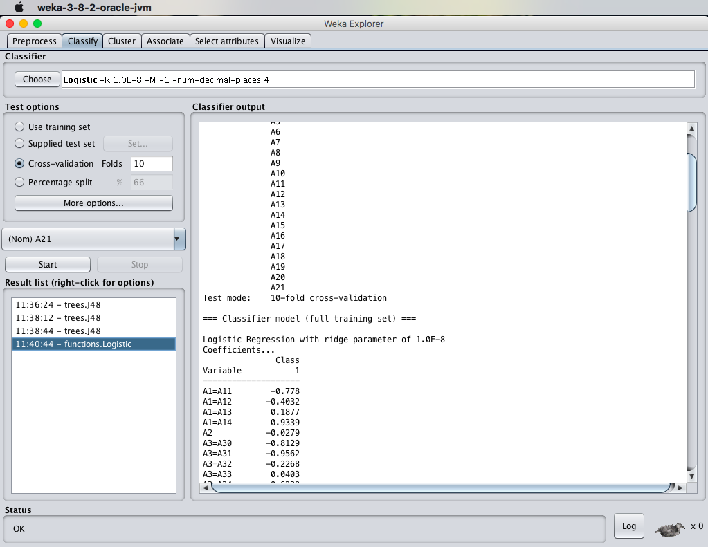

---

#### Screenshot 2: `step_02_page_63_Image242.png`

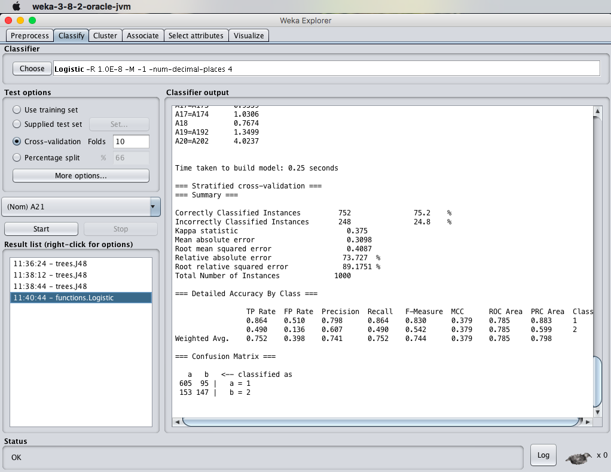

---

#### Screenshot 3: `step_03_page_64_Image245.png`

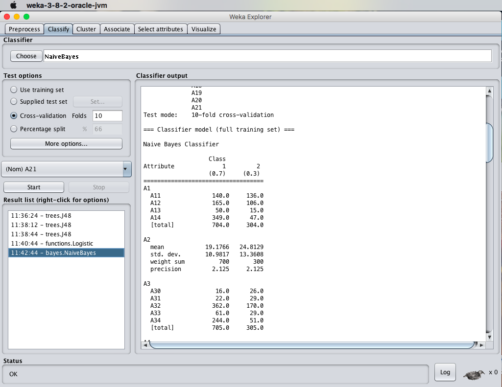

---

#### Screenshot 4: `step_04_page_64_Image246.png`

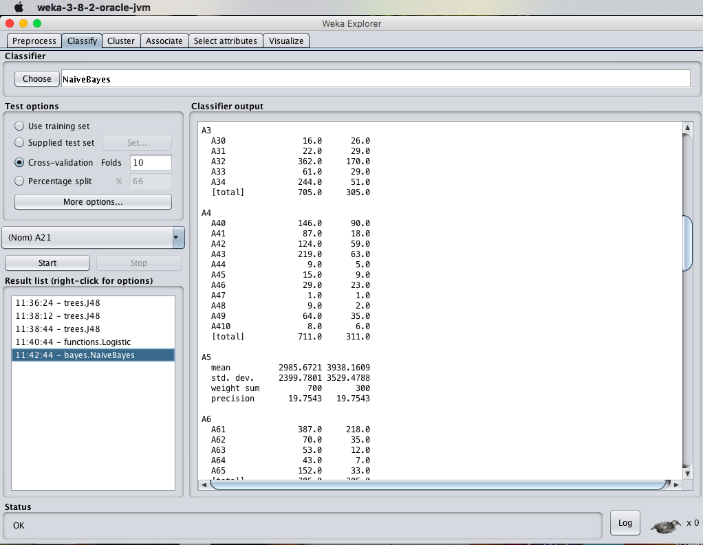

---

#### Screenshot 5: `step_05_page_65_Image249.png`

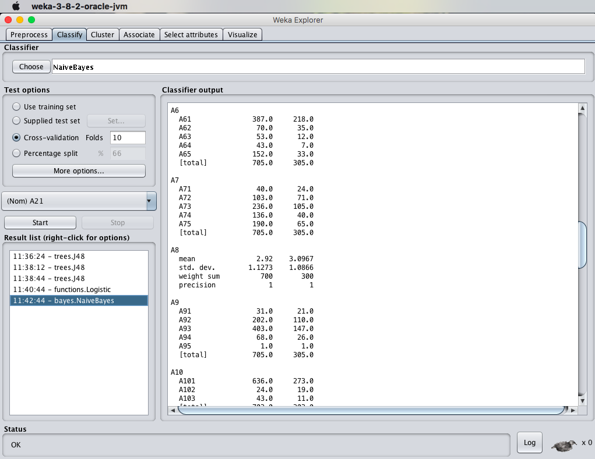

---

#### Screenshot 6: `step_06_page_65_Image250.png`

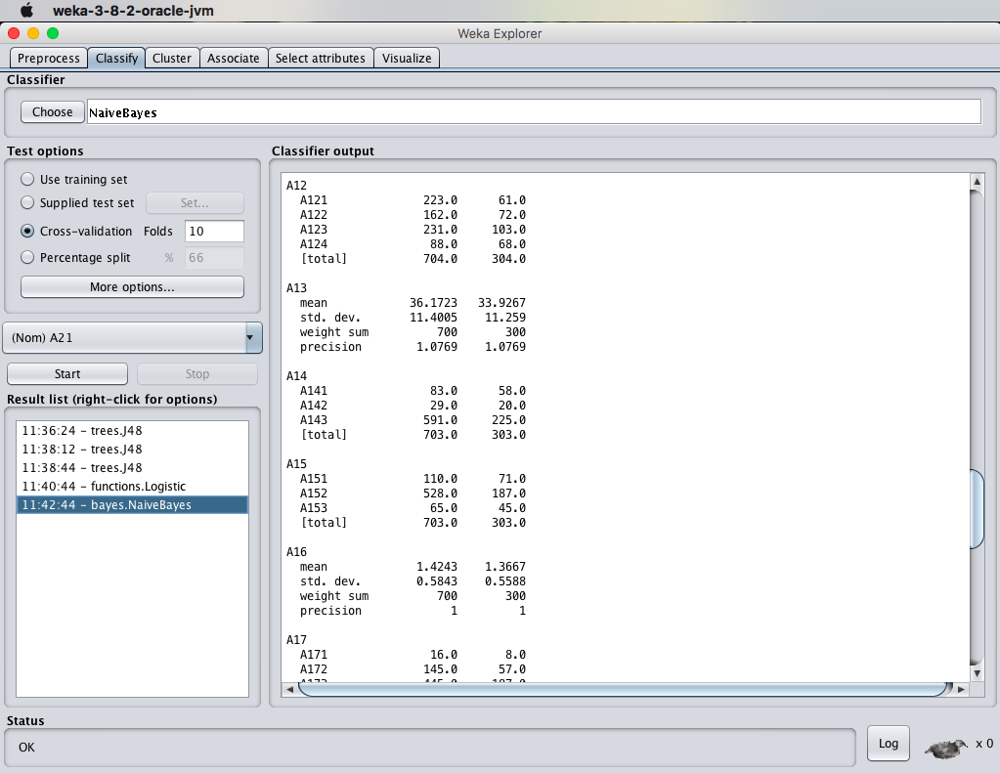

---

#### Screenshot 7: `step_07_page_66_Image253.png`

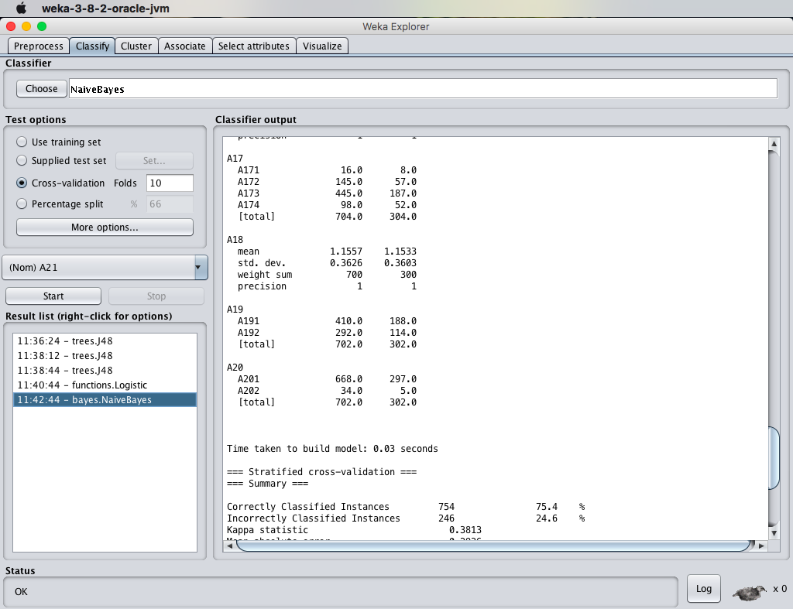

---

#### Screenshot 8: `step_08_page_66_Image254.png`

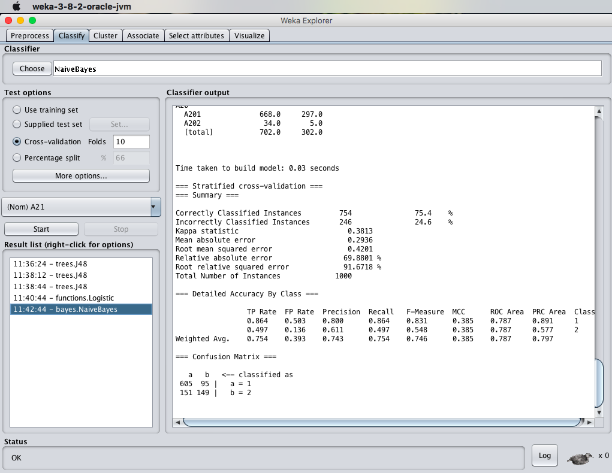

---

#### Screenshot 9: `step_09_page_67_Image201.png`


---

#### Screenshot 10: `step_10_page_68_Image220.png`

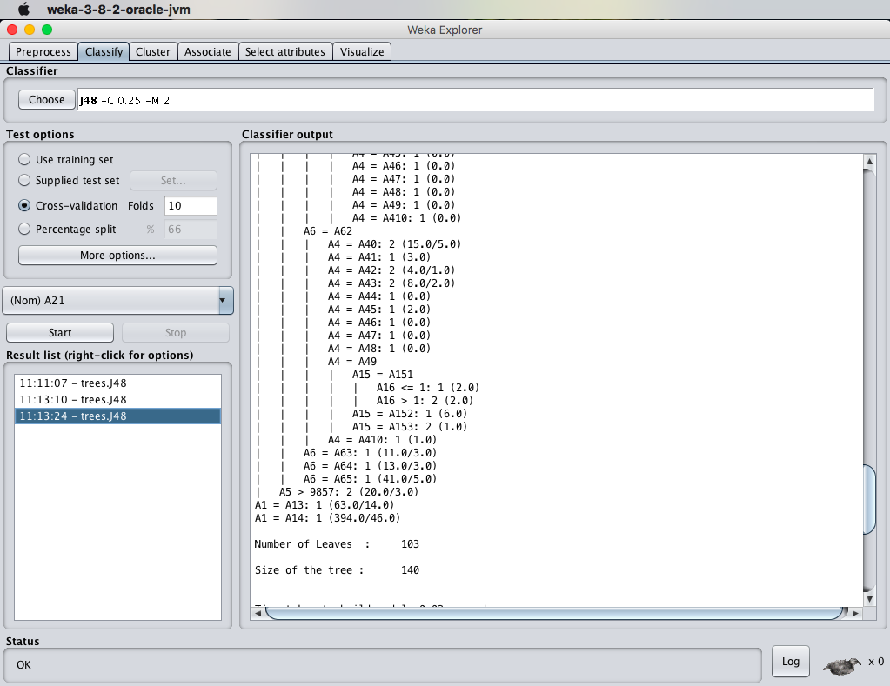

---

#### Screenshot 11: `step_11_page_68_Image223.png`


---

#### Screenshot 12: `step_12_page_69_Image193.png`


---

#### Screenshot 13: `step_13_page_70_Image263.png`

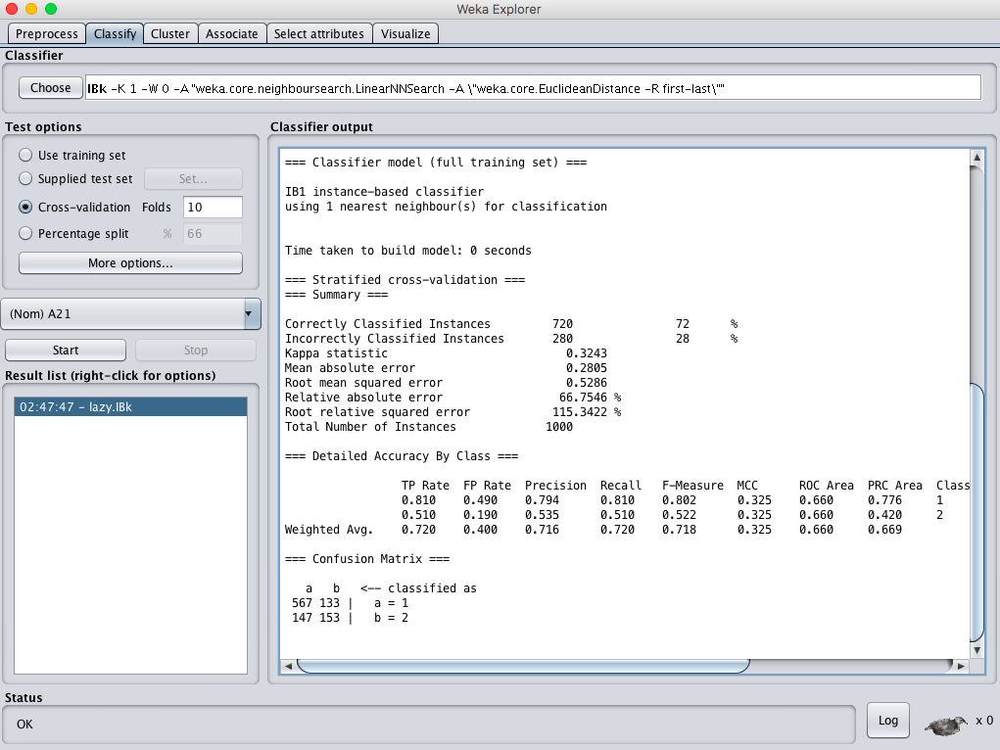

---

#### Screenshot 14: `step_14_page_71_Image226.png`

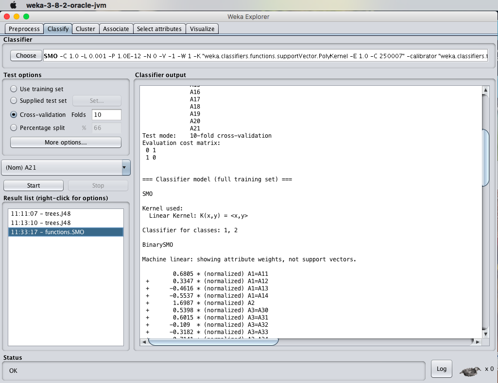

---

#### Screenshot 15: `step_15_page_71_Image227.png`

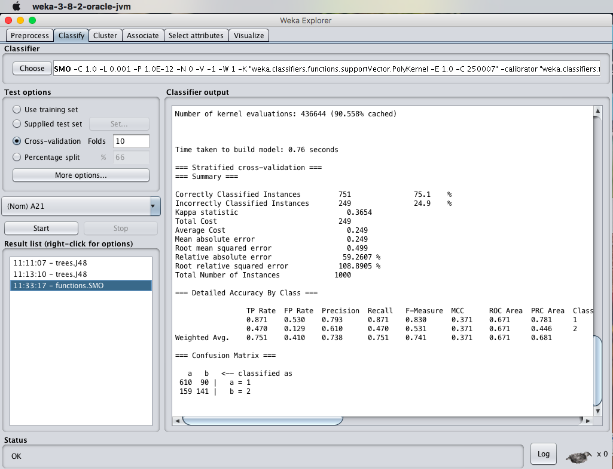

---

#### Screenshot 16: `step_16_page_72_Image268.png`

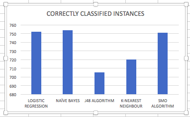

---

#### Screenshot 17: `step_17_page_72_Image269.png`

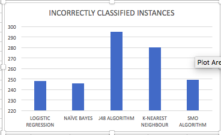

---

#### Screenshot 18: `step_18_page_73_Image272.png`

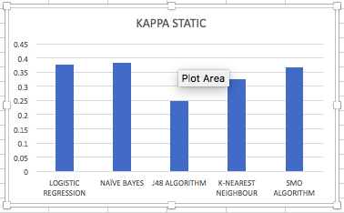

---

#### Screenshot 19: `step_19_page_73_Image273.png`

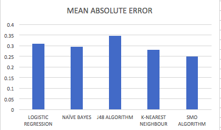

---

#### Screenshot 20: `step_20_page_74_Image276.png`

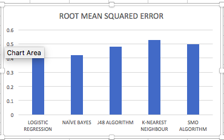

---

#### Screenshot 21: `step_21_page_74_Image277.png`

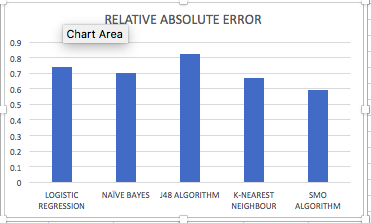

---

#### Screenshot 22: `step_22_page_75_Image280.png`

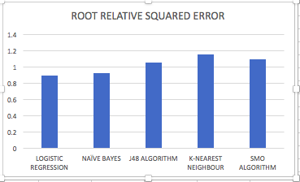

---

#### Screenshot 23: `step_23_page_75_Image281.png`

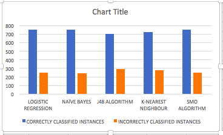

---

#### Screenshot 24: `step_24_page_76_Image284.png`

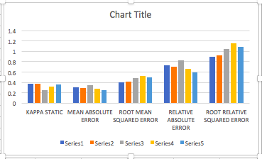

---


---

## 🎯 Result
> [!NOTE]
> **Thus, the comparison of the confusion matrix for all the methods and techniques has been successfully executed in R-Tool.**
